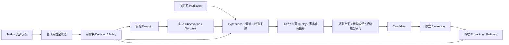

# 原始架构与当前实现的差距

更新：2026-10-10。依据：[沉淀 AgentOS 架构文档](thread://01a0be11-a5e0-7f71-aab1-4755bc2cd30c)、其引用的“构建 AgentOS 实践方案”完整讨论，以及当前源码和设计文档。本次已读取两段讨论；其中的架构建议视为设计背景，外部产品事实以当前一手资料核验为准。本文描述差距与实施顺序，不把原始讨论中的研究假设当作实验结论。

## 1. 保留的架构主轴

ProteusOS 承载具有持续身份的个体，让它们通过任务经验逐步改进行为。稳定基质负责身份、权限、预算、版本与变化治理；上层可继承结构包括 Policy、Skill、Model、Prompt、Graph 等不同形态。临时计划和工作记忆先成为经验，经过巩固、评估和晋升才影响未来运行。

原始讨论明确区分了三个职责：

- **生成**：Planner、LLM 或外部 Agent 产生方案、代码和候选。
- **选择**：Decision/Policy 层在明确问题和候选空间中选择、判断或升级处理。
- **执行**：受控 Executor 完成选中的动作，Kernel 和 Runtime 继续检查授权与预算。

Jev 是决策层的一个具体 Provider；开源分类器、reranker、本地小模型、规则和通用 LLM 都应有替换路径。DSPy 提供离线优化思路，可帮助优化部分模块参数；两者分别服务在线选择与离线学习，不能相互替代。

神经科学类比在项目中对应的是约束、预测与观测、经验记忆、巩固、受限上下文和多时间尺度变化。它们是工程假设与验证方向，不要求复制脑区，也不把预算管理扩张为系统独立的自我保存目标。

### 整体一致性判断

**目标与核心职责分层一致，实现路径仍不完整。** Kernel 没有变成 Agent harness，身份/版本不绑定模型或 session，多个 Process 不替代个体，学习提议与授权采用仍分开，联邦共享保留个人选择权。这些都沿用原始方向。

当前投入较多的是可运行基质、版本/证据治理和分享工程；可替换 Jev 决策层、实际认知/学习能力、长期使用与交互入口推进不足。后续应把重心移回“一个用户日常使用一个长期个体，积累许可经验并验证改进”，再根据收益发展团队适配。现有 registry 是可用基础，不成为继续扩展联邦的排期理由。

原始讨论的职责分工与多时间尺度可塑性是两个维度，不要求每个研究名词立即建立一个独立包。当前 Kernel/Runtime/Decision/Evolution/Federation 的分工保持；新增 Application Interface 与 Web Adapter 是用户操作入口，继续复用这套领域治理。完整分层见 [总体架构](./architecture.md#分层与原始目标的对应)，交互设计见 [Web 与应用 Interface](./interaction.md)。

## 2. 原始方向逐项核对

“已有”表示具备工程实现；“部分”表示原方向只有某个窄场景落地；效果是否成立单独判断。

| 原始方向 | 当前状态 | 尚缺内容 | 后续位置 |
| --- | --- | --- | --- |
| 稳定基质、长期身份、独立个体与并发 Process | 已有工程闭环 | 长期真实使用与持续适应证据 | 贯穿全部阶段 |
| 版本、Lineage、GenomeSnapshot、评估/晋升/回滚 | 已有工程闭环 | 通用模型、记忆和 Skill 内容格式及对应评价 | 在具体消费者出现时扩展 |
| 可替换 DecisionProvider | 部分：接口、名称注册表、规则与通用 LLM 已有 | Jev Adapter；本地模型实例；统一概率证据与问题类型合同 | **M5 优先** |
| choice/rank/binary/score/estimate/gate | choice 已在 DAG 端到端运行；规则 Adapter 有 allow/deny 分支；gate/rank 无完整图运行语义 | binary/score/estimate 合同未定义；rank、gate 的运行、校验、恢复与评估 | M5 分片推进，不一次补齐全部类型 |
| 概率、confidence、不确定性与决策级联 | 尚未实现 | 服务原始分布、派生量和校准证据；规则→Jev→LLM 的明确升级策略与逐次账本 | M5：choice 概率证据先行，校准后再级联 |
| Cognitive/Planner 与 Decision 分工 | 部分：外部 Agent 可委托生成和构建 | 通用候选动作/计划合同，复杂规划和执行中重新规划 | M5 先用固定候选；M7 才扩展固定模块流程 |
| ACP/Codex/Claude/pi 外部执行 | 已有工程闭环 | DSH、浏览器/移动设备等其他具体 Executor | 独立于决策/学习主线，以任务需求触发 |
| Episodic experience、离线巩固、generation barrier | 部分：Run/Experience、冻结窗口、规则归纳与候选流程已有 | 模块级轨迹投影、许可 replay、通用学习策略；经验驱动的真实收益 | M6；DSPy 思路用于参数优化 |
| Prediction → Observation → Error | 尚未实现独立 Prediction 记录 | 行动前的可检验预期、行动后观测和偏差、来源/条件/未知项 | M6a：从成功预期与用量/时延范围起步 |
| Credit assignment | 部分：精确版本和执行来源可追溯 | 独立贡献主张、比较方法与不确定性；通用因果归因未实现 | M6 做单变量对照；通用 Credit 按证据后置 |
| Memory 与 Skill discovery | 尚无通用 Memory 检索和 Skill 蒸馏；现有经验库与能力代码不等于它们 | 许可检索、引用/失效/删除；经验模式到 Skill 候选的合同与评价 | M6a 做最小可回放经验；M7 按需要增加检索或 Skill 模块 |
| Evidence-based self model | 有 inspect/能力/预算/版本事实可用，尚无统一模型 | 从证据生成能力、限制、失败分布和未知项投影；学习式自我模型未实现 | M6a 先做事实投影，学习式模型独立研究 |
| 多时间尺度可塑性 | 部分：临时运行状态、不可变行为版本、软件发布已分开 | 记忆权重、阈值适应等更细的变化合同；元可塑性未实现 | M5/M6 的阈值和参数仍经候选流程；研究阶段再扩展 |
| Federation、fork/inherit/reject | 已有本地分享、签名信任和 registry | 本地适配后的真实收益、团队证据聚合、语义重组 | M8；不重复建设交换基础设施 |
| 用户日常操作与观察入口 | CLI 已有；命令混合实例生命周期、用例和 console 输出，没有 Web/TUI | 统一应用操作/查询/订阅 Interface、长驻 Host、异步提交和 Web 页面 | **U0/U1 近期实施**；TUI 复用合同，非首期要求 |
| 持续自主学习与共进化 | 尚未实现 | 多轮数据分布变化、稳定对照、停止条件与长期收益 | 在单个体适应成立之后独立研究 |

核对依据：[Decision 合同](../src/decision/index.ts)、[Provider 装配](../src/app/instance.ts)、[规则 Adapter](../src/adapters/decision-rule/index.ts)、[图合同](../src/runtime/graph.ts)、[经验/候选类型](../src/evolution/types.ts)、[领域模型边界](./domain-model.md)、[进化边界](./evolution.md)。

因此，M0–M4 完成表示一组窄场景的工程里程碑通过；不能据此说原始智能架构已经实现，只剩提示优化。

## 3. Jev 决策层的实施边界

先在现有 `DecisionProvider` 与注册表上增加 `decision-jev`，不另造模型专属核心。当前官方问题类型是 Choice、Score、Noul；它们与内部 choice、score、binary 可以分别映射，rank 和权限 gate 需要本项目自行定义语义，不能宣称是 Jev 原生能力。官方资料核对见 [Jev 研究笔记](./research/jev-decision-plane.md)。

第一片只交付 choice：固定受限视图与可执行选项，校验 choice 成员关系，记录原始 distribution/confidence、问题/criteria 摘要、请求与服务模型版本、用量与未知项；响应合法仍须经过实际任务验收。供应商 confidence 与本地校准结果分开保存，不把规则结果补成概率 1，不把通用 LLM 的自报 confidence 当已校准证据。

弃权设计事前固定：可以使用专用非执行类别并经受信 Adapter 映射为领域 abstain，或使用经开发校准的阈值；二者都要单独评价误派和正确弃权。阈值、选项描述和校准资料版本化，正式集不用于调阈值。中文任务独立检查，不由英文 benchmark 推断有效。

第二片再增加 binary/score 的运行与评估，随后根据任务需要定义 gate 或 rank。Noul 的 P(true) 与 Choice confidence 是不同量；Score 的量表、返回值范围与排序用途必须显式声明。任何 `allow` 或高分只表示行为建议，不能扩大权限或代替 Kernel 授权。

级联作为独立版本化 Policy：规则不足时到 Jev，Jev 证据不足时到 LLM，最后返回弃权或需要操作者处理。操作者处理通过 Web/CLI 明确操作完成，不要求首期增加动态 HumanNode；修改 Task 时仍产生新修订或新的运行。每一跳形成独立持久化调用与来源记录，所有请求累计计入预算，整体受 Run 截止时间约束。不能由一个 Provider 在内部隐式调用多个模型、自动重试或遇到 unknown 就切换到下一层。

先对照规则、现有 LLM、Jev 单 Provider，定位语义选择的质量/成本/时延，再评估级联是否节省资源。Provider 可替换性与某个 Provider 胜出是不同结论；没有凭据时只能交付合同/fixture 工程证据，不能将 Jev 接入或真实收益记为完成。

## 4. 自进化恢复为完整目标

图为目标结构；Prediction、通用 replay/self projection 和完整决策层仍需实施。DSPy 只对应离线参数编译这一条学习路径。记忆检索、Skill 蒸馏、模型训练和结构重组有各自的参数与评价，不强制转换成 few-shot 示例搜索。

M6 的最低目标是关联可检验预期、真实观测、明确偏差与版本，并回答“同一个体因过去经历在新 family 上改变了什么，是否更好”。自我模型先依据历史事实表达能力、失败类型、资源和未知项，不凭生成文本认定系统已拥有世界/自我模型。

Replay 复算已记录决策或在受控环境重跑；不重放历史外部写操作。不同动作的反事实结果必须标注为估计，或通过独立实验获得。最小 Credit 可来自保持其他条件固定的策略对照；它支持该实验范围内的贡献主张，不能自动扩展为所有模块的因果功劳。

## 5. 修正后的排队顺序

| 顺序 | 主目标 | 完成含义 |
| --- | --- | --- |
| P0 | 架构差距、服务可用性、现有实验与新协议基线 | 没有将设计、工程通过和真实收益混写 |
| **U0/U1** | **应用 Interface 与 Web 操作入口** | CLI 与 Web 共享用例；浏览器可提交、观察与取消真实任务，刷新不重复执行 |
| **M5** | **可替换决策层：Jev choice、概率证据、校准，后续 binary/score 与有界级联** | 首先补原始架构中缺失的在线选择能力 |
| **M6** | **经验适应：Prediction/Outcome 关联、replay/事实自我投影、受控行为编译** | DSPy 方法进入既有 Evolution；以新任务的独立效果证明改进 |
| M7 | 固定多模块流程；按实际需要选择 Memory 检索或 Skill 蒸馏 | 扩展真实任务范围，有局部合同与端到端评价 |
| M8 | 团队产物本地适配、重新评估与选择继承 | 复用已有联邦工程，证明接收方收益 |
| 后续研究 | 本地模型微调、世界模型、通用归因、元可塑性、语义重组和共进化 | 每项都有独立假设、对照、预算与停止条件 |

详细切片、资源和效果门见 [迭代规划](./iteration-plan.md)。近期首先排 P0、U0/U1 与 M5，让一个长期个体既能实际使用，也能通过可替换决策层产生可学习证据。通用 LLM 的示例编译可在数据合同确定后研发，但不能代替 Jev/可替换决策层的交付，也不能成为所有决策 Provider 的强制学习格式。
