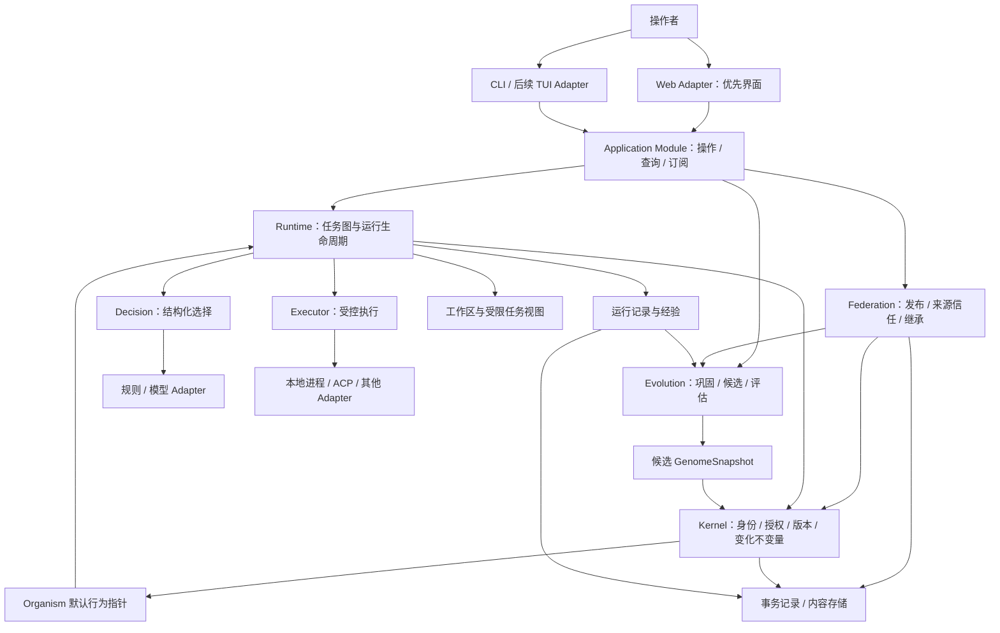

# 总体架构

设计基线：稳定基质维护身份、约束、不可变版本和受控变更；Runtime 组织执行；Evolution 从证据提出改进；外部模型和 Agent 通过 Provider 接入。Application Module 提供统一操作、查询和订阅，Web 为优先交互 Adapter，CLI 保留、未来 TUI 复用相同 Interface。采用单仓库、模块化单进程控制面起步，执行工作可以分布到多个受控进程。

## 系统结构

下图表示目标职责和主要数据流，不表示每个框都需要独立包或服务。统一 Application Interface、Web 与长驻 Host 尚未实现；当前 CLI 仍直接组装领域操作。



## 分层与原始目标的对应

职责分层和可塑性分层是两个不同维度。前者决定一个操作由哪个 Module 负责；后者决定某类状态多久、凭什么证据和授权可以改变。

| 职责层 | 拥有的行为 | 当前与目标的关系 |
| --- | --- | --- |
| 交互 Adapter | Web 页面、CLI 输出、未来 TUI 导航 | CLI 已有；Web 优先实施，共享应用 Interface 待提取 |
| Application Module | 用例编排、身份与个体上下文、命令回执、授权查询与订阅 | 现有 app 装配/命令是起点；长驻 Host 与稳定交互合同待完成 |
| Runtime 与领域工作 | 运行生命周期、Decision、候选/评价流程、发布与继承 | 部分工程闭环已成立；Jev、完整类型化决策与持续适应继续补齐 |
| 认知与学习策略 | 生成候选、预测、记忆/Skill、PolicyLearner、参数编译 | 外部 Agent 承载部分生成；一般规划、预测与记忆不是已完成能力 |
| Kernel 稳定基质 | 身份、访问权、版本/快照、晋升不变量 | 已实现，不导入 UI、HTTP、模型或数据库驱动 |
| Persistence 与 Provider Adapter | 持久化、blob、外部模型/执行协议映射 | 实现可替换 seam；不获得领域选择或授权权力 |

各层不是串行必经步骤：Evolution 可以提交评价 Run，Decision 可以选择已固定的候选，Kernel 可以被多个领域 Module 调用。认知/学习策略提供候选与证据，权限及生效规则始终保留在现有领域合同中。

| 可塑性层 | 典型内容 | 变化规则 |
| --- | --- | --- |
| L0：稳定基质 | 身份、权限、版本完整性、晋升/回滚协议 | 受审查的软件发布与迁移；不参加日常自动学习 |
| L1：架构与学习机制 | Module 组合、评价协议、学习方法、Provider 拓扑 | 慢变化，独立审查/比较与兼容验证 |
| L2：可继承行为 | Skill、Policy、模型、Prompt、Graph、能力实现 | 精确版本、Candidate、独立 Evaluation 与授权 Promotion |
| L3：适应状态 | 任务内工作记忆、可调整上下文、未来的记忆权重/阈值 | 有用途和生命周期；影响跨 Run 行为的阈值仍须版本化与受控采用 |
| L4：临时运行状态 | 当前计划、scratchpad、执行进度 | 可快速变化，关联来源；不自动作为下一代行为 |

L3/L4 部分机制仍未实现。Web/CLI 实现通过普通软件开发迭代；它们呈现个体状态与变化依据，不作为持续身份或学习主体。详细一致性核对见 [架构差距](./architecture-gaps.md)，交互合同见 [Web 与应用 Interface](./interaction.md)。

### Application 与交互 Adapter

共享 Interface 应隐藏身份检查、实例生命周期、操作幂等、后台执行和事件游标；调用者获取结构化回执、授权 DTO 与订阅。Web、CLI、TUI 的展示与输入各自实现。Application Module 调用 Runtime/Evolution/Federation 等用例，不把领域不变量复制到页面或 HTTP handler。

首个 Web 交付包括个体总览、任务提交、Run DAG/事件/结果、决策证据，以及候选比较与显式晋升/回滚。界面与 Jev 并列为近期工作；能力未实现时明确标注，不以界面模型数据代替真实闭环。长任务由应用 Host 承载，浏览器刷新只影响观察。

### Kernel：稳定规则

拥有身份归属、授权判断、资源约束、ArtifactVersion 与 Lineage 不变量、快照完整性和晋升提交规则。它知道“这个版本能否被合法采用”，不知道某份内容是如何完成代码审查的。

Kernel 不依赖外部执行协议或模型 SDK。固定的图算法、检索、学习和评估策略不进入核心不变量。它也不需要理解每种 skill 的语义：内容有效性由受信任的类型校验和评估实现给出，kernel 核查其版本、证据及授权。

“稳定”表示不参加日常自动进化，不表示永不修复。基质、持久化格式和授权规则通过受审查的软件发布、迁移及兼容性验证更新，不能由普通候选绕过。

### Runtime：执行生命周期

拥有 Task、Run、Process、Attempt 的状态机，以及图验证、就绪队列、并发配额、取消、恢复、上下文装配和执行结果验收。Runtime 在新 Run 开始时取得不可变 GenomeSnapshot，此后依照快照使用策略与能力。普通运行采用个体默认快照；评估运行经独立授权显式绑定候选或基线快照，且不改变默认行为。

初始实现采用有限 DAG；重试有次数和预算上限。Planner 可以提供图候选，但不能直接将任意生成图交给执行器。动态图、长驻任务和跨机器调度在明确需要时扩展。

### Decision：选择机制

当前将有限 choice 交给规则或通用 LLM，校验结果并记录来源；不支持、超时、弃权与非法输出分别结案。DecisionProvider 与名称注册表已有，规则 Adapter 还包含 allow/deny 分支，但 gate/rank 没有完整 DAG 运行语义。Jev、本地决策模型、统一概率证据、校准与决策级联尚未实现。Decision 是 Runtime 的独立 seam，Provider 不拥有权限或晋升权。

原始方向为可替换的 Decision/Policy 层：Jev、规则、本地分类器或小模型分别实现具体合同；生成方案与选择行为分开，Serving 与 Learning 分开。DSPy 思路用于离线优化部分模块参数，不能代替在线决策层。尚未落地的原始方向与优先级见 [架构差距](./architecture-gaps.md) 和 [迭代规划](./iteration-plan.md)。

Planner 的开放式生成可先由 Executor 承载，不为尚无第二种实现的能力创建额外公共接口。形成独立需求后再引入生成模块。

### Evolution：变化机制

消费经过授权的经验快照，生成 Candidate，委托固定条件下的评估，形成晋升建议。它可以使用与在线任务相同的执行机制，但配额、工作区和数据权限分开。

学习算法不知道如何改写 active 指针；晋升必须跨过 Kernel 的授权与一致性检查。评估器与 Consolidation 提议算法可独立演进，其评估依据不能由同一个候选自行替换。

Federation 组织团队发布、导入与本地继承，并封装发布来源签名、接收方信任和精确版本 registry。来源认证、传输授权和本地评估分别检查；网络交换不授予运行或晋升权限。详见 [ADR 0010](./adr/0010-signed-sharing-and-registry.md)。

### Persistence 与 Adapter：具体实现

Persistence 提供事务、事件持久化、版本内容寻址和恢复能力；Provider Adapter 将内部合同映射为规则、进程或外部协议。应用入口负责组装依赖，领域模块不在内部自行创建外部客户端。

持久化已采用 node:sqlite 单 writer 与内容寻址 blob；事务内保存状态、事件和派发记录，外部调用在事务外执行。ACP 与 pi SDK 接入同一执行合同，不定义内部 Task、Run 或 Lineage。

## 两个闭环

在线闭环：

```text
Task → 验证约束 → 固定行为快照 → 组织 Process
     → 决策 → 授权与预算检查 → 执行 → 观测与验收 → Experience
```

离线闭环：

```text
Experience 快照 → 巩固/学习 → Candidate → 固定基线 Evaluation
              → 授权 Promotion → 新默认 GenomeSnapshot → 后续 Run
```

这两个闭环可以同时运行。晋升不会更换已开始 Run 的版本，失败学习不会改变在线默认行为。学习也是可观察、有预算和可取消的工作。

## 身份、并发与隔离

默认一个用户控制一个 Organism；一个 Organism 可以有多个 Run，每个 Run 包含多个 Process，一个 Process 可有多次 Attempt。外部 Agent session 和操作系统 PID 是 Adapter 的实现细节。

同一个 Organism 的多个 Process 汇入共同的经验归属，但各自使用明确的运行上下文。跨 Run 的可继承行为更新集中通过晋升提交，不允许并发任务直接覆盖共享 skill 文件。

工作区隔离与权限隔离是不同要求。独立 worktree 可以隔离代码修改，却不能限制网络、宿主文件或凭据访问；实际隔离能力由执行环境提供，启动前检查其是否满足任务权限要求。具体执行语义见[Runtime](./runtime.md)。

团队拥有独立产物谱系和选择规则，不必伪装为一个共享个人身份。个人导入团队版本后仍需本地评估与授权。数据模型保留 scope/owner/provenance，从首版起所有本地记录带归属；签名来源信任与 HTTP registry 已完成工程验收，生产网络部署和大规模联邦继续后置。

## 模块的权责

| 模块 | 权威状态或规则 | 对外小接口 | 明确交给其他模块的职责 |
| --- | --- | --- | --- |
| Application | 用例上下文、操作回执、实例生命周期、授权查询与订阅 | 任务/演化/共享操作与观察 | 具体渲染、模型推理、版本晋升不变量 |
| Web / CLI / TUI Adapter | 输入、导航、展示与传输映射 | 调用共享应用 Interface | 直接写存储、授予权限、实现领域状态机 |
| Kernel | 身份、版本与晋升不变量、授权约束 | 注册版本、解析快照、检查授权、提交晋升/回滚 | 图调度、模型推理、训练算法 |
| Runtime | 任务运行和执行状态机 | 提交、观察、取消、恢复 | 产物选择生效、外部协议细节 |
| Decision | 结构化问题、结果校验与调用来源 | 决策 | 授权、训练、实际副作用 |
| Evolution | 候选与评估流程 | 提出候选、比较、请求晋升 | 绕过 kernel 修改默认行为 |
| Federation | 发布、来源信任与继承治理 | 发布、验签、导入、构造本地继承候选 | 替代本地评估与晋升 |
| Persistence | 持久化实现与提交一致性 | 事务、追加记录、读取内容 | 领域选择策略 |
| Adapter | 协议映射、能力报告、执行反馈 | 满足对应 Provider 合同 | Organism 主权、任务验收 |

表内接口描述行为合同，不是最终函数列表。模块以能封装多少一致性和恢复复杂度为依据，不以目录数或抽象层数衡量。

## 关键不变量

1. 所有默认行为变化都能关联到目标个体、确切版本、证据和有权执行的主体。
2. ArtifactVersion 与 GenomeSnapshot 不可变；active 是使用关系，不是版本内容上的可变标记。
3. 一个 Run 及其重试绑定同一快照；采用新版本需创建关联的新 Run。
4. 晋升以目标当前 revision 为前提原子提交；并发修改冲突不能静默覆盖。
5. 事件回放只能重建状态，不能再次执行历史外部操作。
6. 无法确认的副作用保留未知状态，不能伪装为失败后自动重试。
7. Learner 只产出候选；决策结果只影响允许范围内的行为，不能扩大权限。
8. 回滚默认行为不会撤销已有副作用，也不会擦除历史证据。

## 当前范围

当前系统支持多个体运行、规则/LLM 决策、外部委托、能力自举、经验驱动策略候选和签名版本交换。统一 Application Interface、长驻 Host/Web、Jev 决策层、最小预测/回放等尚需实施；动态图、持续自主学习、大规模联邦与研究型模型能力仍未实现。原始目标保持持续个体的经验适应，剩余工作统一记录于路线图。

源码布局见[仓库设计](./repository.md)，记录关系见[领域模型](./domain-model.md)，实现阶段见[路线图](./roadmap.md)。
