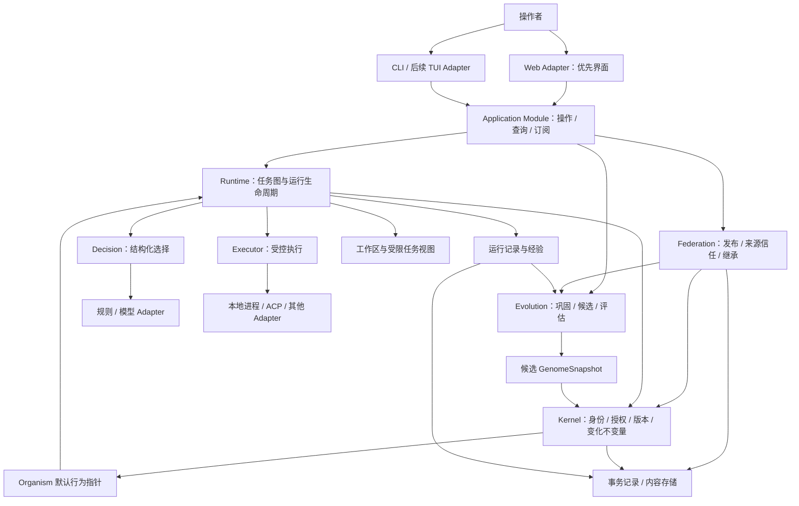
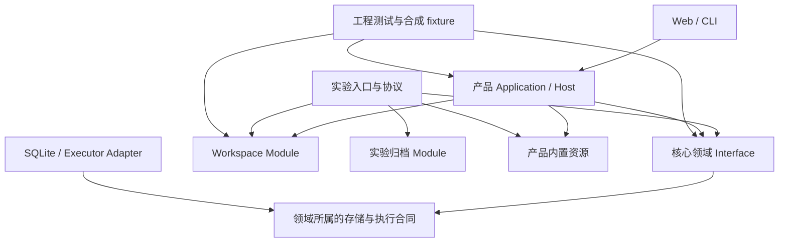

# 总体架构

设计基线：稳定基质维护身份、约束、不可变版本和受控变更；Runtime 组织执行；Evolution 从证据提出改进；外部模型和 Agent 通过 Provider 接入。Application Module 提供统一操作、查询和订阅，Web 为优先交互 Adapter，CLI 保留、未来 TUI 复用相同 Interface。采用单仓库、模块化单进程控制面起步，执行工作可以分布到多个受控进程。

## 系统结构

下图表示目标职责和主要数据流，不表示每个框都需要独立包或服务。Web 与长驻 Workbench Host 已有实现；CLI 与工作台仍有各自的编排，统一 Application Interface 尚未完成。实验、验证和工作区的重新分层提案见本文末节。



## 分层与原始目标的对应

职责分层和可塑性分层是两个不同维度。前者决定一个操作由哪个 Module 负责；后者决定某类状态多久、凭什么证据和授权可以改变。

| 职责层 | 拥有的行为 | 当前与目标的关系 |
| --- | --- | --- |
| 交互 Adapter | Web 页面、CLI 输出、未来 TUI 导航 | CLI 与 Web 已有；共享应用 Interface 待提取 |
| Application Module | 用例编排、身份与个体上下文、命令回执、授权查询与订阅 | Workbench Host 已有；通用实例装配与具体用例仍需分离 |
| Runtime 与领域工作 | 运行生命周期、Decision、候选/评价流程、发布与继承 | 部分工程闭环已成立；Jev、完整类型化决策与持续适应继续补齐 |
| 认知与学习策略 | 生成候选、预测、记忆/Skill、PolicyLearner、参数编译 | 外部 Agent 承载部分生成；一般规划、预测与记忆不是已完成能力 |
| Kernel 稳定基质 | 身份、访问权、版本/快照、晋升不变量 | 已实现，不导入 UI、HTTP、模型或数据库驱动 |
| Persistence 与 Provider Adapter | 持久化、blob、外部模型/执行协议映射 | 实现可替换 seam；不获得领域选择或授权权力 |

各层不是串行必经步骤：Evolution 可以提交评价 Run，Decision 可以选择已固定的候选，Kernel 可以被多个领域 Module 调用。认知/学习策略提供候选与证据，权限及生效规则始终保留在现有领域合同中。

| 可塑性层 | 典型内容 | 变化规则 |
| --- | --- | --- |
| L0：稳定基质 | 身份、权限、版本完整性、晋升/回滚协议 | 受审查的软件发布与迁移；不参加日常自动学习 |
| L1：架构与学习机制 | Module 组合、评价协议、学习方法、Provider 拓扑 | 慢变化，独立审查/比较与兼容验证 |
| L2：可继承行为 | Skill、Policy、模型、Prompt、Graph、能力实现 | 精确版本、Candidate、独立 Evaluation 与授权 Promotion |
| L3：适应状态 | 任务内工作记忆、可调整上下文、未来的记忆权重/阈值 | 有用途和生命周期；影响跨 Run 行为的阈值仍须版本化与受控采用 |
| L4：临时运行状态 | 当前计划、scratchpad、执行进度 | 可快速变化，关联来源；不自动作为下一代行为 |

L3/L4 部分机制仍未实现。Web/CLI 实现通过普通软件开发迭代；它们呈现个体状态与变化依据，不作为持续身份或学习主体。详细一致性核对见 [架构差距](./architecture-gaps.md)，交互合同见 [Web 与应用 Interface](./interaction.md)。

### Application 与交互 Adapter

共享 Interface 应隐藏身份检查、实例生命周期、操作幂等、后台执行和事件游标；调用者获取结构化回执、授权 DTO 与订阅。Web、CLI、TUI 的展示与输入各自实现。Application Module 调用 Runtime/Evolution/Federation 等用例，不把领域不变量复制到页面或 HTTP handler。

首个 Web 交付包括个体总览、任务提交、Run DAG/事件/结果、决策证据，以及候选比较与显式晋升/回滚。界面与 Jev 并列为近期工作；能力未实现时明确标注，不以界面模型数据代替真实闭环。长任务由应用 Host 承载，浏览器刷新只影响观察。

### Kernel：稳定规则

拥有身份归属、授权判断、资源约束、ArtifactVersion 与 Lineage 不变量、快照完整性和晋升提交规则。它知道“这个版本能否被合法采用”，不知道某份内容是如何完成代码审查的。

Kernel 不依赖外部执行协议或模型 SDK。固定的图算法、检索、学习和评估策略不进入核心不变量。它也不需要理解每种 skill 的语义：内容有效性由受信任的类型校验和评估实现给出，kernel 核查其版本、证据及授权。

“稳定”表示不参加日常自动进化，不表示永不修复。基质、持久化格式和授权规则通过受审查的软件发布、迁移及兼容性验证更新，不能由普通候选绕过。

### Runtime：执行生命周期

拥有 Task、Run、Process、Attempt 的状态机，以及图验证、就绪队列、并发配额、取消、恢复、上下文装配和执行结果验收。Runtime 在新 Run 开始时取得不可变 GenomeSnapshot，此后依照快照使用策略与能力。普通运行采用个体默认快照；评估运行经独立授权显式绑定候选或基线快照，且不改变默认行为。

初始实现采用有限 DAG；重试有次数和预算上限。Planner 可以提供图候选，但不能直接将任意生成图交给执行器。动态图、长驻任务和跨机器调度在明确需要时扩展。

### Decision：选择机制

当前将有限 choice 交给规则或通用 LLM，校验结果并记录来源；不支持、超时、弃权与非法输出分别结案。DecisionProvider 与名称注册表已有，规则 Adapter 还包含 allow/deny 分支，但 gate/rank 没有完整 DAG 运行语义。Jev、本地决策模型、统一概率证据、校准与决策级联尚未实现。Decision 是 Runtime 的独立 seam，Provider 不拥有权限或晋升权。

原始方向为可替换的 Decision/Policy 层：Jev、规则、本地分类器或小模型分别实现具体合同；生成方案与选择行为分开，Serving 与 Learning 分开。DSPy 思路用于离线优化部分模块参数，不能代替在线决策层。尚未落地的原始方向与优先级见 [架构差距](./architecture-gaps.md) 和 [迭代规划](./iteration-plan.md)。

Planner 的开放式生成可先由 Executor 承载，不为尚无第二种实现的能力创建额外公共接口。形成独立需求后再引入生成模块。

### Evolution：变化机制

消费经过授权的经验快照，生成 Candidate，委托固定条件下的评估，形成晋升建议。它可以使用与在线任务相同的执行机制，但配额、工作区和数据权限分开。

学习算法不知道如何改写 active 指针；晋升必须跨过 Kernel 的授权与一致性检查。评估器与 Consolidation 提议算法可独立演进，其评估依据不能由同一个候选自行替换。

Federation 组织团队发布、导入与本地继承，并封装发布来源签名、接收方信任和精确版本 registry。来源认证、传输授权和本地评估分别检查；网络交换不授予运行或晋升权限。详见 [ADR 0010](./adr/0010-signed-sharing-and-registry.md)。

### Persistence 与 Adapter：具体实现

Persistence 提供事务、事件持久化、版本内容寻址和恢复能力；Provider Adapter 将内部合同映射为规则、进程或外部协议。应用入口负责组装依赖，领域模块不在内部自行创建外部客户端。

持久化已采用 node:sqlite 单 writer 与内容寻址 blob；事务内保存状态、事件和派发记录，外部调用在事务外执行。ACP 与 pi SDK 接入同一执行合同，不定义内部 Task、Run 或 Lineage。

## 两个闭环

在线闭环：

```text
Task → 验证约束 → 固定行为快照 → 组织 Process
     → 决策 → 授权与预算检查 → 执行 → 观测与验收 → Experience
```

离线闭环：

```text
Experience 快照 → 巩固/学习 → Candidate → 固定基线 Evaluation
              → 授权 Promotion → 新默认 GenomeSnapshot → 后续 Run
```

这两个闭环可以同时运行。晋升不会更换已开始 Run 的版本，失败学习不会改变在线默认行为。学习也是可观察、有预算和可取消的工作。

## 身份、并发与隔离

默认一个用户控制一个 Organism；一个 Organism 可以有多个 Run，每个 Run 包含多个 Process，一个 Process 可有多次 Attempt。外部 Agent session 和操作系统 PID 是 Adapter 的实现细节。

同一个 Organism 的多个 Process 汇入共同的经验归属，但各自使用明确的运行上下文。跨 Run 的可继承行为更新集中通过晋升提交，不允许并发任务直接覆盖共享 skill 文件。

工作区隔离与权限隔离是不同要求。独立 worktree 可以隔离代码修改，却不能限制网络、宿主文件或凭据访问；实际隔离能力由执行环境提供，启动前检查其是否满足任务权限要求。具体执行语义见[Runtime](./runtime.md)。

团队拥有独立产物谱系和选择规则，不必伪装为一个共享个人身份。个人导入团队版本后仍需本地评估与授权。数据模型保留 scope/owner/provenance，从首版起所有本地记录带归属；签名来源信任与 HTTP registry 已完成工程验收，生产网络部署和大规模联邦继续后置。

## 模块的权责

| 模块 | 权威状态或规则 | 对外小接口 | 明确交给其他模块的职责 |
| --- | --- | --- | --- |
| Application | 用例上下文、操作回执、实例生命周期、授权查询与订阅 | 任务/演化/共享操作与观察 | 具体渲染、模型推理、版本晋升不变量 |
| Web / CLI / TUI Adapter | 输入、导航、展示与传输映射 | 调用共享应用 Interface | 直接写存储、授予权限、实现领域状态机 |
| Kernel | 身份、版本与晋升不变量、授权约束 | 注册版本、解析快照、检查授权、提交晋升/回滚 | 图调度、模型推理、训练算法 |
| Runtime | 任务运行和执行状态机 | 提交、观察、取消、恢复 | 产物选择生效、外部协议细节 |
| Decision | 结构化问题、结果校验与调用来源 | 决策 | 授权、训练、实际副作用 |
| Evolution | 候选与评估流程 | 提出候选、比较、请求晋升 | 绕过 kernel 修改默认行为 |
| Federation | 发布、来源信任与继承治理 | 发布、验签、导入、构造本地继承候选 | 替代本地评估与晋升 |
| Persistence | 持久化实现与提交一致性 | 事务、追加记录、读取内容 | 领域选择策略 |
| Adapter | 协议映射、能力报告、执行反馈 | 满足对应 Provider 合同 | Organism 主权、任务验收 |

表内接口描述行为合同，不是最终函数列表。模块以能封装多少一致性和恢复复杂度为依据，不以目录数或抽象层数衡量。

## 关键不变量

1. 所有默认行为变化都能关联到目标个体、确切版本、证据和有权执行的主体。
2. ArtifactVersion 与 GenomeSnapshot 不可变；active 是使用关系，不是版本内容上的可变标记。
3. 一个 Run 及其重试绑定同一快照；采用新版本需创建关联的新 Run。
4. 晋升以目标当前 revision 为前提原子提交；并发修改冲突不能静默覆盖。
5. 事件回放只能重建状态，不能再次执行历史外部操作。
6. 无法确认的副作用保留未知状态，不能伪装为失败后自动重试。
7. Learner 只产出候选；决策结果只影响允许范围内的行为，不能扩大权限。
8. 回滚默认行为不会撤销已有副作用，也不会擦除历史证据。

## 当前范围

当前系统支持多个体运行、规则/LLM 决策、外部委托、能力自举、经验驱动策略候选、签名版本交换及本地 Web 工作台。统一 Application Interface、Jev 决策层、最小预测/回放等尚需实施；动态图、持续自主学习、大规模联邦与研究型模型能力仍未实现。原始目标保持持续个体的经验适应，剩余工作统一记录于路线图。

源码布局见[仓库设计](./repository.md)，记录关系见[领域模型](./domain-model.md)，实现阶段见[路线图](./roadmap.md)。

## 实验、验证与工作区重新分层

状态：2026-10-30 已按下述顺序实施模块迁移；当前落点与运行方式见[仓库设计](./repository.md#实验测试与工作区迁移2026-10-30)。以下保留本轮设计依据和验收目标；远端历史更新仍为独立操作。保持单包模块化，先建立可检查的依赖方向，再按实际发布需求考虑拆包。

### 现状与问题

迁移前核对到的耦合有四类（下表记录问题来源，旧路径已迁移）：

| 代码落点 | 实际耦合 | 影响 |
| --- | --- | --- |
| `src/app/instance.ts` | 通用 `openInstance` 装配 `guardObservedRun`、`guardDiagnosticRun`、`AdaptiveJournal` 和编译实验绑定 | 普通产品实例知道具体研究协议，实验增长会扩大所有实例的装配面 |
| `src/storage/store.ts` | 从 `app/experiment` 导入 journal/development 记录，并直接提供 workbench 存储方法 | 持久化实现同时承载领域、研究和界面用例；类型归属与事务边界混在一起 |
| `experiments/protocols/observed-runner.ts`、`src/app/cli.ts` | 从 `tests/fixtures` 加载能力资源，实验 runner 还读取 `docs/experiments/results` | 可运行代码依赖源码检出布局；产品资源、测试样本和历史结果相互倒置 |
| `tests/integration/diagnostic-experiment.test.ts`、`src/app/workbench/workspace.ts` | 日常回归解压四份真实归档；工作区则把所有纳入文件变成字符串 | 产品测试依赖历史实例，文本投影被误当作完整执行环境 |

十份原始归档约 34.4 MiB。归档体积是上述耦合的结果之一；只搬文件或扩大文本大小限制不能解除依赖。前期按扩展名排除压缩归档的临时行为已移除；执行快照现在保留二进制文件，模型上下文独立投影。

### 核心系统保留什么

这里的核心系统包括 Kernel、Runtime、Decision、Evolution、Federation 及其所属的持久化合同，不只指 Kernel。

| Module | 应拥有的规则 | 外层负责的选择 |
| --- | --- | --- |
| Kernel | 身份、授权、不可变版本/快照、晋升 CAS | 哪个实验值得做、项目如何展示 |
| Runtime | Run/Attempt 状态、预算预留与消耗、派发、取消、unknown、恢复、固定输入与验收证据关联 | 实验分组、样本选择、源码仓库布局 |
| Decision | 请求/响应合同、选择有效性、调用来源与计量 | 某次研究采用的模型和提示参数 |
| Evolution | 许可经验、候选、独立 Evaluation、eligibility、受权采用 | 样本量、统计方法、特定实验的阶段与收益门槛 |
| Federation | 发布来源、访问权、信任和本地继承治理 | 原始实验备份存在哪个服务 |

**Evaluation 是产品能力；Experiment 是核心能力的消费者。** 产品必须能在没有研究目录和历史归档的情况下，对候选运行固定验证、拒绝不完整证据并控制采用。`development`/`validation` 用途隔离、预算、来源核验也不能因为名称出现在实验文件中就一起搬走。

提取规则：具有产品消费者并维护通用不变量的行为归相应领域 Module；仅描述某一协议的阶段、条件、数据集或报告的行为归 Experiment。暂时只有一个消费者的辅助逻辑留在其内部，避免建立万能实验插件框架。

### 目标依赖方向与装配

箭头表示依赖，不表示每层都需要网络服务。



执行环境由宿主组装。Runtime 消费固定输入与执行工作区的合同；Git 选择、模型上下文投影和修改应用由 Workspace Module 实现。Kernel 不理解文件扩展名、Git 或本机目录。

目标组织：

```text
src/kernel, runtime, decision, evolution, federation  核心领域
src/app/                                            产品用例、宿主、装配
src/workspace/                                      文件快照、物化、变更与应用
src/resources/                                      运行产品必需的 seed/能力/规范
src/storage/                                        各 Module 的 SQLite Adapter
experiments/                                        特定协议、数据生成、runner、报告和复验
tests/fixtures/                                     最小合成样本与构造器
docs/experiments/                                   协议说明、可审阅摘要与归档清单
```

目标约束：生产源码不读取 `tests/`、`docs/` 或 `experiments/`；实验可以调用核心和产品 Interface，核心与产品默认入口不能反向导入实验。实验所需的私有入口与测试仍随实验源码维护；完整工程检查应覆盖它们，不能靠移出 TypeScript/Vitest 范围隐藏错误。

`openInstance` 只装配通用能力。实验入口显式装配协议约束，产品入口装配 Workbench 用例。现有 `runGuard` 可作为迁移 seam，但不能直接删除检查：

- 准入、开始和派发的约束绑定需要持久化身份与版本；恢复时缺少对应实现必须拒绝执行该 Run。不能通过普通入口绕过实验限制。
- 约束只增加限制，不能放宽 Kernel 授权、Runtime 预算或替换固定裁判；普通任务不能自行注入任意检查代码。
- 预算预留、Run 绑定与派发状态继续在原有一致性单元中完成。耗时 I/O 不进入事务；跨进程检查结果必须绑定版本并在提交点重验。
- `experimentId` 当前承担计量作用，第一阶段保留字段和历史读取。只有产品确有第二种分组预算需求时，再迁为通用预算范围；迁移不得重置已消耗或未知额度。

Storage 按合同所有者拆分有类型的 Adapter，实验表合同归实验、工作台表合同归产品、Runtime 表合同归 Runtime。可以继续共享一个 SQLite 连接和事务协调器；不能为了目录分离拆成无法原子提交的多个数据库。既有迁移编号和历史记录保留兼容，后续迁移按所有者登记。`workbenchGet<T>` 式任意 JSON 访问不再作为上层公共 Interface。

### Workspace Module：三种范围分别冻结

一个项目需要三份相关但不同的范围：

| 范围 | 表示什么 | 例子 |
| --- | --- | --- |
| Execution snapshot | 执行和检查实际需要的文件、权限与内容摘要 | 源码、图片、测试所需二进制 fixture、配置 |
| Context projection | 允许发送给模型或展示的内容及预算 | 被选择的文本片段、文件元数据、可支持的媒体 |
| Change set | 本次允许运回原项目的变化 | 文本修改；二进制变化的摘要/大小与独立应用策略 |

不能用 UTF-8 解码能力决定文件能否进入执行副本。执行文件采用字节内容引用，文本只是可选视图。1 MiB 若作为展示/模型读取上限，应限制该次读取或要求显式分段；执行快照另有总量、单文件、文件数配额，超限需给出选择和原因，不能悄悄截断。

建议的外部 Interface 是少量完整操作，名称为设计草案：

| 操作 | 返回与必须维护的语义 |
| --- | --- |
| `capture(project, policy)` | 不可变快照引用与清单；固定纳入/排除规则、字节摘要、必要权限位和来源，报告缺失依赖 |
| `materialize(snapshot, executionRoot)` | 可重建执行副本及输入身份；从冻结字节恢复，不能重新读取可能已变化的原项目 |
| `collect(snapshot, executionRoot)` | 结构化变更与证据；记录二进制修改，未支持的应用类型明确阻止应用，不能过滤成“无变化” |
| `apply(changeSet, expectedBaseline)` | 冲突检查、应用回执和可恢复状态；失败留下可核对备份，恢复不覆盖用户随后产生的新修改 |

Git 是捕获来源的一种实现；第一阶段沿用现有 Git 文件选择，冻结未提交修改与明确纳入的未跟踪文件，不同时实现多种后端。子模块、符号链接、LFS 的支持按能力声明；遇到未支持且必需的输入时预检失败。依赖安装属于显式准备步骤，执行命令与副作用单独记录。

输入与输出不能共用一个静默过滤器：输入排除应在预检清单与任务记录中可见；输出必须发现纳入范围内的内容变更和违规输出。保密目录的访问限制需要执行环境落实，单纯不复制文件不构成沙箱。

Runtime 只绑定输入快照、运行目录和产物证据，不负责 Git 分支、项目选择和 UI diff。Workspace 只处理文件生命周期，不定义 Run 成功、候选 eligible 或权限授权。核对和写入原项目之间仍可能发生外部并发修改，应用合同必须覆盖这种冲突，不能声称一次前置 hash 检查提供了文件系统事务。

### 测试、实验与证据的生命周期

| 活动 | 输入 | 证明的结论 | 默认执行方式 |
| --- | --- | --- | --- |
| 产品工程回归 | 小型合成 fixture、公开 Interface 构造的临时实例 | 不变量、兼容、恢复和用例行为 | `pnpm check`，不依赖历史实验或外网 |
| 实验协议工程测试 | 合成模型响应、临时 ledger、冻结小数据集 | 预算、分组、结案和报告算法正确 | 纳入工程检查，按实验测试目录组织 |
| 历史证据复验 | 指定归档及摘要、兼容版本 | 某份历史记录能被验证或复算 | 独立显式入口；缺包则报告未执行/失败，不能标通过 |
| 真实实验 | 预注册协议、许可数据、显式凭据与预算 | 限定任务与条件下的效果及局限 | 独立授权运行，结果不自动晋升 |

`diagnostic-experiment.test.ts` 的四个历史父实例应由合成构造器替代，走真实的准入、结案与持久化路径。保留当前所有行为断言，增加对构造器所提供前置条件的合同校验；不能改成缺少归档便跳过测试，也不能直接伪造一个通过审计的生产数据库。

只有验证历史格式兼容确实需要的最小样本可以入库，需注明来源、大小上限和不能自动生成的原因。归档复验可继续读取旧格式；真实历史记录不冒充合成 fixture。

运行证据和历史备份也应分开：核心运行所需的输入、版本、调用和验收引用保留在受治理的实例存储中；封闭实验的备份与分析材料迁到独立归档目录或长期存储。实例删除、证据导出和归档保留分别受自身策略控制。

仓库保存实验报告、审计脚本、协议版本及归档清单；清单至少记录摘要、大小、来源版本、获取位置、格式版本与复验入口。归档根目录由调用者指定，复验先核摘要再解包，并检查路径越界和解包资源上限。产品启动和普通测试不自动下载归档。

### 可独立验收的迁移顺序

| 步骤 | 改动范围 | 完成条件 |
| --- | --- | --- |
| 1. 固定依赖规则 | 记录当前违规点，加入导入及资源读取约束；将产品使用的能力 fixture 移到 `src/resources` | 核心禁止新增上层依赖；产品资源可随发布输入单独运行；既有例外逐项有迁移归属 |
| 2. 测试自给与归档接口 | 替换四个历史父实例；归档复验接受显式目录；整理十份归档清单和外部备份 | 移走原始归档后，全部原有工程断言仍执行并通过；备份摘要核验通过 |
| 3. 实验装配外移 | 分离实验入口、协议和存储 Adapter；按实际规则提取通用预算/绑定能力 | 普通实例不加载实验代码；实验重启、unknown、并发预留与缺少约束实现时的拒绝行为通过 |
| 4. 工作区合同替换 | Workbench 改用快照、字节引用和变更集，分开执行输入与上下文投影 | 含图片/二进制 fixture 的项目能执行检查；文本/二进制差异、限额、冲突和应用恢复均有合同覆盖 |
| 5. 仓库及历史清理 | 修正文档路径、打包配置和忽略规则，独立克隆执行历史清理 | 无 `docs`、历史归档或测试 fixture 的产品运行包通过冒烟检查；干净检出可跑工程检查；保留旧新提交映射后再单独确认远端更新 |

步骤 2 与 4 可以分别落地；步骤 3 涉及现有派发保证，应在测试可独立构造状态后推进。每步维护旧记录读取和现有任务恢复，避免一次性搬目录使运行语义不可核对。Git 历史重写属于最后的数据迁移操作，不是完成架构重构的证据。

架构验收除了检查源码导入，还需检测运行时资源读取：在临时产品目录中移除 `tests/`、`docs/`、`experiments/`，验证实例初始化、普通任务、候选评价和工作台基本操作；另在不含历史归档的源码检出中运行默认工程检查。仅用 import 正则不能证明文件系统依赖已解除。
