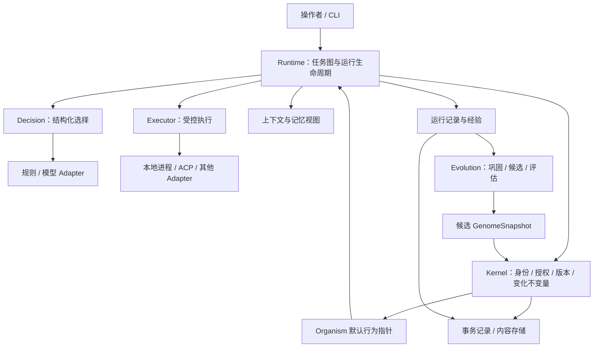

# 总体架构

设计基线：稳定基质维护身份、约束、不可变版本和受控变更；Runtime 组织执行；Evolution 从证据提出改进；外部模型和 Agent 通过 Provider 接入。采用单仓库、模块化单进程控制面起步，执行工作可以分布到多个受控进程。

## 系统结构

下图表示职责和主要数据流，不表示每个框都需要独立包或服务。



### Kernel：稳定规则

拥有身份归属、授权判断、资源约束、ArtifactVersion 与 Lineage 不变量、快照完整性和晋升提交规则。它知道“这个版本能否被合法采用”，不知道某份内容是如何完成代码审查的。

Kernel 不依赖 ACP、某个模型 SDK、Cordis 或 DSH。固定的图算法、检索、学习和评估策略不进入核心不变量。它也不需要理解每种 skill 的语义：内容有效性由受信任的类型校验和评估实现给出，kernel 核查其版本、证据及授权。

“稳定”表示不参加日常自动进化，不表示永不修复。基质、持久化格式和授权规则通过受审查的软件发布、迁移及兼容性验证更新，不能由普通候选绕过。

### Runtime：执行生命周期

拥有 Task、Run、Process、Attempt 的状态机，以及图验证、就绪队列、并发配额、取消、恢复、上下文装配和执行结果验收。Runtime 在新 Run 开始时取得不可变 GenomeSnapshot，此后依照快照使用策略与能力。普通运行采用个体默认快照；评估运行经独立授权显式绑定候选或基线快照，且不改变默认行为。

初始实现采用有限 DAG；重试有次数和预算上限。Planner 可以提供图候选，但不能直接将任意生成图交给执行器。动态图、长驻任务和跨机器调度在明确需要时扩展。

### Decision：选择机制

将有限候选、排序或判断问题交给规则或模型；负责校验结果、记录来源，并在不支持、超时或无法判断时按版本化策略处理。Decision 是 Runtime 的独立 seam，Provider 不拥有权限或晋升权。

Planner 的开放式生成可先由 Executor 承载，不为尚无第二种实现的能力创建额外公共接口。形成独立需求后再引入生成模块。

### Evolution：变化机制

消费经过授权的经验快照，生成 Candidate，委托固定条件下的评估，形成晋升建议。它可以使用与在线任务相同的执行机制，但配额、工作区和数据权限分开。

学习算法不知道如何改写 active 指针；晋升必须跨过 Kernel 的授权与一致性检查。Evaluator、PolicyLearner 的策略可演进，其评估依据不能由同一个候选自行替换。

### Persistence 与 Adapter：具体实现

Persistence 提供事务、事件持久化、版本内容寻址和恢复能力；Provider Adapter 将内部合同映射为规则、进程或外部协议。应用入口负责组装依赖，领域模块不在内部自行创建外部客户端。

建议以 SQLite 加内容文件存储起步；它是待验证的部署选择，不属于领域模型。ACP 是优先验证的外部执行协议，不定义内部 Task、Memory 或 Lineage。

## 两个闭环

在线闭环：

```text
Task → 验证约束 → 固定行为快照 → 组织 Process
     → 决策 → 授权与预算检查 → 执行 → 观测与验收 → Experience
```

离线闭环：

```text
Experience 快照 → 巩固/学习 → Candidate → 固定基线 Evaluation
              → 授权 Promotion → 新默认 GenomeSnapshot → 后续 Run
```

这两个闭环可以同时运行。晋升不会更换已开始 Run 的版本，失败学习不会改变在线默认行为。学习也是可观察、有预算和可取消的工作。

## 身份、并发与隔离

默认一个用户控制一个 Organism；一个 Organism 可以有多个 Run，每个 Run 包含多个 Process，一个 Process 可有多次 Attempt。外部 Agent session 和操作系统 PID 是 Adapter 的实现细节。

同一个 Organism 的多个 Process 汇入共同的经验归属，但各自使用明确的运行上下文。跨 Run 的可继承行为更新集中通过晋升提交，不允许并发任务直接覆盖共享 skill 文件。

工作区隔离与权限隔离是不同要求。独立 worktree 可以隔离代码修改，却不能限制网络、宿主文件或凭据访问；实际隔离能力由执行环境提供，启动前检查其是否满足任务权限要求。具体执行语义见[Runtime](./runtime.md)。

团队拥有独立产物谱系和选择规则，不必伪装为一个共享个人身份。个人导入团队版本后仍需本地评估与授权。数据模型保留 scope/owner/provenance，从首版起所有本地记录带归属；团队网络服务延后。

## 模块的权责

| 模块 | 权威状态或规则 | 对外小接口 | 明确交给其他模块的职责 |
| --- | --- | --- | --- |
| Kernel | 身份、版本与晋升不变量、授权约束 | 注册版本、解析快照、检查授权、提交晋升/回滚 | 图调度、模型推理、训练算法 |
| Runtime | 任务运行和执行状态机 | 提交、观察、取消、恢复 | 产物选择生效、外部协议细节 |
| Decision | 结构化问题与结果校验、回退规则 | 决策 | 授权、训练、实际副作用 |
| Evolution | 候选与评估流程 | 提出候选、比较、请求晋升 | 绕过 kernel 修改默认行为 |
| Persistence | 持久化实现与提交一致性 | 事务、追加记录、读取内容 | 领域选择策略 |
| Adapter | 协议映射、能力报告、执行反馈 | 满足对应 Provider 合同 | Organism 主权、任务验收 |

表内接口描述行为合同，不是最终函数列表。模块以能封装多少一致性和恢复复杂度为依据，不以目录数或抽象层数衡量。

## 关键不变量

1. 所有默认行为变化都能关联到目标个体、确切版本、证据和有权执行的主体。
2. ArtifactVersion 与 GenomeSnapshot 不可变；active 是使用关系，不是版本内容上的可变标记。
3. 一个 Run 及其重试绑定同一快照；采用新版本需创建关联的新 Run。
4. 晋升以目标当前 revision 为前提原子提交；并发修改冲突不能静默覆盖。
5. 事件回放只能重建状态，不能再次执行历史外部操作。
6. 无法确认的副作用保留未知状态，不能伪装为失败后自动重试。
7. Learner 只产出候选；决策结果只影响允许范围内的行为，不能扩大权限。
8. 回滚默认行为不会撤销已有副作用，也不会擦除历史证据。

## 当前范围

首个可用系统包含稳定 seed、规则 Decision、本地受控执行、运行记录、不可变版本和最小晋升流程；然后接入一个真实编码执行器，完成自举闭环。World Model、复杂记忆、局部模型微调、语义重组和跨主体共进化按证据逐步加入。

源码布局见[仓库设计](./repository.md)，记录关系见[领域模型](./domain-model.md)，实现阶段见[路线图](./roadmap.md)。
