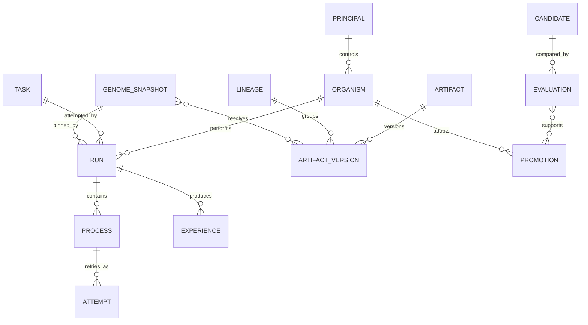

# 领域模型与记录关系

状态：设计基线；字段是概念合同，不是已发布数据库 schema。词义以 [CONTEXT.md](./CONTEXT.md) 为准；这里补充关系、归属和不变量。

## 1. 身份与执行关系

图中只画主要关系。版本的 parents 构成可跨谱系的 DAG；快照的完整内容、运行环境与晋升前提见下文。

| 对象 | 最小字段 | 约束 |
| --- | --- | --- |
| Principal | id、kind、授权关系引用 | kind 可为 user/organism/team；身份不自动带权限 |
| Organism | id、owner、scope、activeGenome、revision | 持续身份；默认行为指针可变，revision 单调递增 |
| Task | id、requestedBy、目标、输入、约束、验收规范引用 | 多个 Run 可尝试同一任务；输入/验收变化须记录新修订 |
| Run | id、taskRef、organismId、purpose、snapshotRef、graphRef、environmentRef、授权引用、预算、状态、supersedesRunId? | 固定 Task 修订与快照；新版本运行可关联旧 Run |
| Process | id、runId、nodeId、职责、能力需求、配额 | MVP 一个执行节点对应一个 Process |
| Attempt | id、processId、ordinal、dispatchId、providerRef、handle?、状态 | 重试新建；远端是否已执行未知时保留 unknown |

Task 的目标不随执行器反馈自动改写。对验收条件的授权修改创建 Task 新修订及新 Run，避免以降低要求“修复”正在失败的任务。Run 的图结构在 MVP 中固定，计划内允许的分支和有界重试属于图语义。

一个外部 session 可以支持同一 Process 的顺序交互；其重连或更换不能改变内部身份归属。具体状态机由 [Runtime](./runtime.md) 维护。

普通 Run 默认绑定 activeGenome；`purpose=evaluation` 的 Run 经独立授权可显式绑定候选或基线快照，并关联 Candidate 与评估计划。候选行为在独立工作区受测，输入和裁判由计划固定；执行候选不构成晋升。

## 2. Artifact、Lineage 与不可变版本

| 对象 | 最小字段 | 约束 |
| --- | --- | --- |
| Artifact | id、kind、lineageId、owner | 稳定用途标识；kind 标识内容合同，不授予执行权 |
| ArtifactVersion | id、artifactId、lineageId、schemaVersion、contentDigest、contentRef、parents[]、dependencies[]、createdBy、provenanceRef | 内容、依赖和来源创建后不可变 |
| Lineage | id、owner、scope、originRefs[] | 表达版本家族的主权；跨谱系 parent 不转移所有权 |
| GenomeSnapshot | id、digest、bindings、resolvedDependencies、createdBy | slot 到精确版本的映射，以及完整依赖闭包；创建后不可变 |

同一 Artifact 的版本属于同一 Lineage。Fork 创建新的 Lineage 和 Artifact 标识，其首版本的 parents 指向来源版本；后续版本在自己的谱系内演进。语义重组允许多个 parents，不表示自动合并内容或自动获得父版本的访问权。

版本 ID 用于稳定引用，contentDigest 用于完整性与内容去重；相同内容可以有不同来源和权限，不能仅凭摘要合并授权对象。Parents 必须存在且不能形成环；外部导入先保留在待验证区，完成来源、权限和依赖校验后才允许进入运行快照。

ArtifactVersion 不含可变的 `active`、`retired` 或累计 fitness。新证据通过独立记录关联，fitness 是某次 Evaluation 在特定条件下的结论。发现版本有问题时追加撤销/禁用记录，不能修改旧内容；授权撤回可以阻止旧 Run 继续使用已固定的版本。

GenomeSnapshot 的 bindings 例如 `routing-policy`、`task-graph`、`review-skill`、`acceptance-evaluator`。依赖解析在快照创建时结束，不能在 Run 内隐式取 `latest`。缺失版本、循环依赖、schema 不兼容或超出授权范围都使快照不可运行。

Organism 的历史由 Run、Promotion 和所选快照串联；持续身份不等于某个 Artifact Lineage。模型替换、执行器退出或回滚都不创建新的 Organism。

## 3. 授权与资源

将 owner、可见性与使用许可分别建模：

- `owner` 指向有治理权的 Principal。
- `scope` 说明资源所属或分享的范围，如指定 organism/team/organization 或 public。
- `grantRef` 指向谁可对什么对象执行什么操作、资源上限及有效期的授权记录。

首版只实现本地 user 与 organism 范围；其他 scope 作为可解析但不可启用的扩展，不默认允许访问。Public 只表示可公开读取，不等于允许执行、晋升或进一步分享私有依赖。

Run 保存准入时的授权引用以便审计，但每次派发仍检查当前撤权和剩余预算。权限不会因为写入快照而永久有效。资源账本至少记录预算预留、消耗、释放与未知成本；多个并发 Run 的配额预留须原子化，不能各自读取同一余额后重复花费。

## 4. 事件、经验与证据

| 对象 | 表达的内容 | 不应混入的内容 |
| --- | --- | --- |
| Event | 某个主体发生的事实，含 stream/seq/schema、因果关联与时间 | 让观察者重新执行命令的隐式指令 |
| Experience | Run、输入、快照、环境、事件区间与 Outcome 的关联 | 将完整原始日志等同于训练许可 |
| Prediction | 预期结果、提出者、依据版本、可选概率与测量定义 | 事后补写的预测 |
| Outcome | 观测值、验收结果、外部状态与未知项 | 执行器未经验证的自评 |
| Evidence | 原始或派生记录引用、所支持主张、方法、适用环境与可见范围 | 无来源的确定性结论 |
| ExperienceDataset | 明确成员、切分、截止点、过滤规则版本、用途许可 | 持续变化的动态查询结果 |
| Credit | 贡献主张、证据集、归因方法、不确定性和适用范围 | 默认因果关系或自动奖励 |

预测需先于相关动作记录；没有共同测量定义的 expected/observed 不能自动相减。Unknown 与 false、zero 分开，成本缺失不能当作免费。经验摘要是派生产物，保留其源记录引用和生成方法。

Memory 是面向任务的经验读取或巩固视图，不是另一个能够绕过版本规则的共享大脑。事实性经历可持续追加；Run 每次检索记录读取截止点、选中内容引用及检索策略版本。新增观测会改变运行上下文，但不能静默改变其可继承规则。冻结经验数据集时固定成员而非仅记录查询语句。

权重可固定的本地模型引用内容摘要；托管模型记录服务、可见版本和请求配置，并明确不可完全重现之处。环境记录工作对象修订、工具版本与必要系统条件，不把保存 trace 等同于可精确重现真实世界。

## 5. 变化记录

| 对象 | 关键引用 | 一致性条件 |
| --- | --- | --- |
| Candidate | target、baseGenome、baseRevision、proposedGenome、datasetRef、hypothesis、proposedBy | 与正在使用的组合分开；变更后创建新候选 |
| Evaluation | candidateRef、baselineRef、protocolRef、evaluatorRefs、datasetSplitRefs、environmentRef、results、metrics、uncertainty | 结论仅适用于这组精确输入 |
| Promotion | operationId、kind、target、from/to、expectedRevision、resultRevision、evaluationRefs、authorizationRef、actor | kind 为 adopt/rollback；成功记录与指针切换同事务 |

Candidate 的流程状态由提议、评估和晋升事件投影得到。首版可只实现 proposed/evaluating/eligible/rejected/stale/adopted；eligible 是证据满足条件，不代表获得晋升授权。

普通 Run 准入时，在一致事务视图中取得 Organism 的 activeGenome/revision 并记录 Run 引用；评估 Run 使用显式授权的精确快照。晋升提交时检查基准快照和 revision、评估的适用性及授权，原子写入成功记录和新指针。并发候选不按最后写入者获胜，旧基准返回 stale。

回滚使用相同提交协议，revision 继续递增；依据历史评估、当前兼容性检查和回滚原因建立记录，不要求重新学习一个候选。不能回滚到依赖缺失、已撤销权限或当前环境不兼容的组合。完整流程见[进化设计](./evolution.md)。

## 6. 持久化与保留边界

建议运行状态、事件、outbox 与晋升记录位于同一个事务存储中，内容 blob 独立不可变存储；具体提交与故障语义见 [Runtime](./runtime.md#7-持久化派发与事件合同)。

状态迁移与对应事实记录不可分离；checkpoint 和查询投影是加速视图，不能成为绕过合法命令迁移的入口。事件 schema 演进需显式版本和迁移，未知类型不静默忽略关键状态变化。

“不可变”约束的是对象仍存在期间不能原地篡改，不代表所有个人数据必须永久保留。删除或到期清理留下不含敏感内容的墓碑、原因和引用失效记录；受影响的数据集不再可完整回放，评估适用性需重新判断。保留期和导出规则在采集真实用户数据前确定。

导出只包含被允许的精确版本、依赖和证据。外部 URL 只是来源，不能替代对导入内容的摘要验证；凭据不作为版本内容、事件字段或训练样本。运行工作区、实例数据和内容存储不提交到源码仓库。
