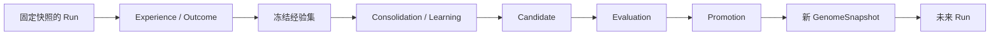

# 自进化、巩固与协作继承

状态：设计基线；文中标为 **proposed** 的实现默认值可在首个原型后修订。本文规定演化对象、证据与晋升协议，不代表相关能力已经实现。

ProteusOS 的自进化是：同一 Organism 从多次任务的经验中提出变化，经独立评估后保留可复用结构，并让未来运行使用这些结构。是否“变好”必须限定任务分布、环境、约束和预算；生成更多内容、完成一次任务或多个 Agent 同时工作，都不足以证明进化。

生物学与神经科学中的个体、遗传、可塑性和巩固在这里是工程类比。它们帮助提出可检验的设计假设，不意味着实现了生物进化、大脑机制或意识，也不产生系统自行延续、扩张资源或扩大权限的目标。

## 1. 哪些东西可以改变

Kernel 维护身份、权限、不可变记录和晋升协议；主要演化对象是其上运行的 ArtifactVersion 组合。Organism 保持身份连续性，通过更新默认 GenomeSnapshot 改变后续行为。

| 层级 | 对象 | 变化方式 | 生效范围 |
| --- | --- | --- | --- |
| L0 Constitutional Substrate | Identity、Artifact/Lineage 规则、隔离、权限、版本、晋升与回滚协议 | 常规软件发布与明确迁移；不进入运行时自主演化 | 指定部署与迁移范围 |
| L1 Architecture | Module 拓扑、学习机制、评估协议 | 低频候选，单独评审与兼容性验证 | 新部署或显式支持的新快照 |
| L2 Heritable Artifacts | Skill、Policy、Model、Graph、Prompt、Tool 描述、Code | Candidate → Evaluation → Promotion | 新 Run |
| L3 Adaptive State | 临时路由权重、阈值、记忆检索权重、用户模型更新假设 | 已授权规则内快速调整，记录输入与变化 | 当前 Run；跨 Run 保留须版本化并晋升 |
| L4 Ephemeral State | 上下文、当前计划、草稿、临时假设 | 执行中随观察变化 | 当前 Run 或 Process |

上述层级描述允许的变化路径，不规定固定的秒、小时或天数。L0“稳定”不等于永远不能修复；L4“临时”也不等于不留审计记录。

L3 不能成为绕过 L2 的通道。阈值或路由权重一旦跨 Run 影响行为，就必须作为精确版本进入 GenomeSnapshot；当前 Run 的快速调整只能写入本次运行状态与经验，不能静默修改其他 Run 的策略。事实性经验可以持续追加，但追加记录本身不构成行为规则的晋升。

已有策略允许的检索、计划修订和预算内探索属于运行行为。改变策略、学习率、晋升阈值或允许学习的对象属于可继承变化；其中控制学习与评估的规则按 L1 处理，不能由被评估候选自行放宽。

## 2. 演化的最小闭环

闭环包含三个独立责任：variation 产生变化，selection 用证据选择，retention 保存经过选择的版本与采用关系。



Variation 可以来自人工修改、规则搜索、模型生成、外部编码执行器、蒸馏或微调。一次经验可以触发候选提议，但不能因为“这次有效”直接成为长期策略。候选可以只改变一个 Skill，也可以提出一组相互依赖的版本；后者必须作为完整快照评估。

Selection 使用预先确定的约束、基线与评估集。Retention 保留精确版本、来源、证据及采用记录；未被采用的候选仍可留下审计记录。保留候选不等于激活候选，保存到仓库也不等于允许执行其代码。

评估通过独立授权的 evaluation Run 显式绑定候选或基线 GenomeSnapshot，无需提前更改 activeGenome。评估计划固定任务输入、裁判与资源范围；候选运行只控制受测行为。该路径与普通 Run 共用执行合同，但不获得默认行为选择权。

## 3. 在线执行与离线学习

在线路径负责观察、决策、执行、记录预期与实际结果。DecisionProvider 提供推断，不通过同一个 Interface 原地训练或覆盖正在服务的模型。

离线路径从冻结的经验集出发，执行整理、去重、模式提取、假设生成、候选构建和评估。PolicyLearner 产出新的 ArtifactVersion 与 Candidate，不直接更新 Organism 的 activeGenome。

“离线”是与在线执行的版本和权限隔离，不要求整个系统休眠。Consolidation 可以与用户 Run 并行，并受独立队列、预算与取消策略约束；它只读取一个已确定的经验窗口，后续经验留给下一轮。

Evolution Module 的 Interface 应隐藏数据切片、评估编排与记录关联的复杂性，向调用者提供候选提交、评估请求和晋升请求等少量操作。其 Interface 包含权限、幂等、版本前置条件和失败语义，不能只是一组方法签名。详见 [系统架构](./architecture.md) 与 [仓库设计](./repository.md)。

## 4. 不可变版本与运行快照

ArtifactVersion 的内容、内容引用、来源和 parents 在创建后不可修改。补充证据以独立记录关联，不能覆盖版本原有来源。Lineage 是有所有者和治理规则的版本家族；parents 可以引用其他 Lineage 的精确版本，形成可追溯的 DAG。

GenomeSnapshot 是不可变的 ArtifactVersion 精确引用集，包含运行需要的完整依赖闭包。不能在执行时把 `latest`、可变标签或上游当前版本解析成隐含依赖。来源指向远程模型时，记录可获得的版本标识及无法固定的部分，不能承诺完全可重现。

Task 是任务目标；Run 是一次完整任务执行；Process 是 Run 内的执行单元，可能委托给外部 Agent session；Attempt 是某个 Process 的一次执行尝试。每个 Run 创建时绑定一个 GenomeSnapshot，Process 和重试均沿用该快照。

Organism 的 `activeGenome` 指向供新 Run 使用的默认快照，并带有单调递增的 `revision`。已启动 Run 不随指针变化。Checkpoint 恢复使用原快照；若必须采用新版本，创建新 Run 并关联原 Run，而不是把恢复伪装成同一次执行。详见 [运行时设计](./runtime.md)。

运行中的计划和上下文仍可变化；这些变化属于运行状态。快照固定的是可继承结构，不意味着每个行动或上下文都预先确定。

## 5. Candidate、Evaluation、Promotion 分别记录

| 记录 | 必须表达的事实 |
| --- | --- |
| Candidate | 目标 Organism/Scope、基准快照与 revision、候选快照、变更动机、来源经验集、提出者、资源预算 |
| Evaluation | Candidate、基线快照、评估协议与裁判版本、数据切分、环境、逐次结果、汇总指标、不确定性、成本、执行者 |
| Promotion | 目标 Organism、旧/新快照、预期/实际 revision、采用的 Evaluation、授权依据、操作者、提交结果与时间 |

这些记录不能合并为 ArtifactVersion 上的 `status`。Candidate 的待评估、拒绝或可晋升状态来自记录投影；`active` 是 Organism 与快照的采用关系，同一版本可以在一个 Organism 中活跃、在另一个中未采用。

一份 Evaluation 只能证明其记录范围内的结果。晋升时仍要检查权限、预算、依赖闭包、基准是否过期以及所需评估是否齐全。评估完成不等于自动授权晋升。

**proposed 默认值：**首版由 operator 批准晋升；系统可以自动收集经验、生成候选和执行已授权的评估。未来可允许低风险 Artifact 类型在指定 Scope、预算、指标与回滚条件内自主晋升，但必须记录授权策略版本。此处是运行产品的治理默认值，不要求批准本文档。

## 6. 评估设计与裁判独立性

评估应在生成候选前确定任务范围、基线、主要指标、不可退化约束和预算。先检查有效性、权限、资源上限与兼容性，再比较任务质量、成功率、延迟、成本、重试和用户纠正等指标；不把所有约束压缩成一个可互相抵消的分数。

最低证据要求包括：

1. 固定独立基线与评估协议版本；新候选和基线在可比较的环境中运行。
2. 将经验中的训练/开发样本与 held-out 验证样本分开，记录来源，避免只测试已经生成答案的任务。
3. 对有随机性的任务重复运行，保留每次结果、失败和方差，记录可用的随机种子与执行器版本。
4. 同时检查目标改善与既有能力回归；覆盖失败样本和预算耗尽，不能只筛选成功日志。
5. 预先限制候选数量、评估调用、资源消耗和停止条件；证据不足时给出“不确定”，不能把评估预算耗尽记为通过。

样本数、最低收益和容忍区间取决于任务与噪声，作为评估协议的参数显式记录；当前不规定一个适用于所有 Artifact 的数值。多次查看同一 held-out 集会使其变成开发反馈，需跟踪使用次数并定期补充独立验证集。

Candidate 可以建议新的评估器或 benchmark，但不能用自己修改的裁判作为唯一晋升依据。评估器候选须由既有独立规则、保留的验证集与 operator 审查验收；裁判与被评估行为同时变化时，拆分为不同候选或固定其中一方进行对照。

原始输出和外部代码属于待检验输入，不能改变评估器的权限、验收条件或事实记录。对于会产生外部副作用的评估，使用隔离环境、受控测试对象或无副作用替身；shadow 执行也不能无条件复制真实写操作。

历史 replay 可以重建决策上下文并检验某些性质，但不能凭一段日志证明“另一个行动一定更好”。外部环境和模型可能已变化，反事实判断需要可比实验或明确标注的推断。

## 7. Generation barrier 与并发晋升

Generation barrier 固定本轮经验窗口、评估 cohort、候选依赖、基线快照和目标 revision。在线 Run 可以继续完成任务并产生下一轮经验；不需要暂停整个系统，也不需要等待所有 Organism 同时进入下一代。

晋升是一次对目标 Organism 的条件更新：仅当当前 `activeGenome` 与 `revision` 仍等于 Evaluation 绑定的基准时，原子写入新快照引用、递增 revision 并记录成功的 Promotion。状态更新与成功记录必须一起提交；调用重试使用幂等标识，不能重复晋升。

```text
Organism: G12 / revision 12
  Candidate A 基于 G12 → 评估通过 → CAS 成功 → G13 / revision 13
  Candidate B 基于 G12 → 评估通过 → CAS 冲突 → stale
  新 Run 绑定 G13；原 Run 仍绑定 G12
```

B 不能因“只修改另一个 Skill”就自动覆盖 A。它必须基于 G13 重新构造候选快照，检查依赖并重新评估组合效果；旧候选和旧 Evaluation 保留。可复用的测试结果须有明确适用条件，不能把旧晋升结论直接搬到新基准。

revision 用于识别 G12 → G13 → G12 的变化过程，即使回滚后快照引用相同，也不能让旧的并发晋升请求意外成功。跨 Organism 的采用独立提交，不引入一个全局“代号”或全局锁。

## 8. 回滚与故障处理

回滚选择一个历史已验证快照，通过同样的权限检查和 CAS 协议生成新的 Promotion，并将其标记为回滚操作。保留坏版本、评估证据和事故记录；回滚不篡改历史，也不把 revision 倒退。

回滚默认只影响未来 Run。已经启动的 Run 继续使用原快照；需要停止时由显式取消流程处理。必要时用旧快照创建恢复任务，而不是热替换运行中依赖。

回滚版本不会撤销已经发送的消息、修改的外部文件、提交的交易或其他副作用。补偿需要单独的授权、执行与审计；没有可靠补偿时必须把未恢复的外部状态明确记录。

进程崩溃、预算耗尽、数据损坏或评估失败都不能留下半激活快照。若已提交成功但响应丢失，调用者按幂等标识查询已有记录；若未提交成功，继续使用原默认快照。

## 9. Experience、Evidence 与 Credit

Experience 描述一次运行中发生的事；Outcome 描述观测到的结果；Evidence 是用于支持或反驳某个主张的记录引用。一次成功可以成为 Evidence，但不是“所有参与 Artifact 都有正贡献”的证明。

每个 Run 至少关联：

- Task、Organism、GenomeSnapshot、Process/Attempt 与执行器版本。
- 使用过的 ArtifactVersion、关键决策输入、预期结果与实际结果；无法获得的字段显式缺省。
- 环境、能力授权、资源预算与实际消耗、重试、评估结果及用户纠正。
- 记录来源、可见 Scope、数据保留与共享限制。

Credit 是对贡献的可追溯假设：关联某个版本、某组证据、所用归因方法、置信限制和适用环境。它不能仅凭相关性宣称因果，也不直接变成奖励或晋升票数。若要识别某个 Skill 的增益，应保持其他版本尽量固定，做消融或对照，并记录实验局限。

首版先保证 provenance 完整，再增加统计归因。没有充分证据时保留“无法区分贡献”，比把成功平均分配给所有 Module 更有价值。

## 10. 团队共享、继承与主权

多个 Process 并行工作可以为同一 Organism 积累经验。多个 Organism 合作完成任务，也不自动意味着共进化；只有合作经验进入各自候选、评估和版本采用过程后，才发生可追溯的长期改变。

团队作为独立的发布与治理 Scope 管理自己的 Lineage。个人默认快照不直接追随团队当前版本；团队发布也不会自动修改成员的私有经验或策略。

共享协议保留四种明确操作：

| 操作 | 含义 | 是否改变接收方运行行为 |
| --- | --- | --- |
| publication | 将精确版本、依赖与允许公开的证据发布到指定 Scope | 否 |
| import | 接收并校验版本、来源与依赖，保留为本地可评估内容 | 否 |
| fork | 创建由接收方治理的 Lineage，parents 保留原版本来源 | 否 |
| inherit | 在本地候选中选择版本，经本地评估与晋升后采用 | 仅影响晋升后的新 Run |

个人可以采用、拒绝、延迟或在 fork 后调整团队版本。父版本来自多个 Lineage 的组合也只是新候选，不因来源可信而免除评估。团队“通过”描述团队环境，不能替代个人目标、能力授权和环境下的验收。

私有经验、提示、凭据、用户偏好与原始任务内容不默认随 Artifact 发布。发布者明确选择共享内容与 Scope，记录必要的过滤与来源限制；接收方仍把外部内容视为待验证数据。团队评估可共享汇总证据，但汇总本身也需要检查是否泄露私有信息。

未来的 semantic crossover 可把多个版本组合成一个多 parents 候选。真正共进化还需要处理多个策略互相改变带来的基线漂移，因此先固定伙伴版本、分轮评估；不在 MVP 中开放所有 Organism 实时互改行为。

## 11. MVP 顺序与验收

MVP 支持单用户、单 Organism、多个 Process 并发。先实现规则、Skill 与 Graph 的演化，验证积累经验是否改善任务；模型微调、架构演化、团队 registry 和共进化按 [路线图](./roadmap.md) 后置。

第一条演化路径可以人工提出候选，也可以从重复失败中提取候选。关键是完成并验证以下行为：

1. 两个并发 Run 使用同一个已固定快照，各自记录完整来源和结果。
2. 从冻结经验集提出一个规则或 Skill 候选，在固定基线与 held-out 任务上评估。
3. operator 批准后提交一次可审计的 Promotion；新 Run 使用新快照，旧 Run 保持原快照。
4. 对同一基准的另一个晋升请求返回 stale，完成重建与重评后才能再次尝试。
5. 将默认快照回滚并再次运行任务，证明版本切换可恢复，同时保留外部副作用记录。

这些结果能证明演化协议可工作，不能提前证明长期收益。收益需要持续比较质量、成本、回归与用户纠正，并允许“不晋升”成为正常结果。相关对象定义见 [领域模型](./domain-model.md)，文档入口见 [设计文档索引](./README.md)。

## 12. 实现注记（M2 最小自举）

M2 落地本文 §5–§8 的最小版本，对应实现与让步：

- **三种记录独立落库**（migration v3）：Candidate（基准快照+revision、候选快照、动机、来源 refs——builder Run 可追溯）；Evaluation（协议 digest、基线、逐 Run 结果、分列指标、verdict）；Promotion（operationId 唯一、kind=adopt/rollback、from/to、expected/result revision、evaluation 引用、actor）。Candidate 流程状态由 `candidate-<id>` 事件流投影（proposed/evaluating/eligible/rejected/stale/adopted），不物化 status 列。
- **候选来源**：M3 前允许人工/委托构建提出（`proteus build`），流程完整记录来源（builder Run id、goal digest、验收时的产出 digest）；builder 产出须经 test-runner 独立验收，采集时内容必须与验收后立即记录的摘要一致，测试失败或产出漂移不能构造候选。
- **评估协议 m2-bootstrap-eval-v1**（构造候选前固定）：Candidate 记录评估计划 digest，覆盖任务、输入内容树、schema、固定期望输出、预算与能力声明；评估时重新计算并拒绝漂移。新能力任务必须实际声明候选能力。候选×新能力验收 + 每项既有能力的候选×回归和基准×回归（健康对照）；基线失败 → `inconclusive`（评估环境不可信，不判 rejected，可重评）——"证据不足不能记通过"。裁判按内容寻址钉住预注册 hybrid 版本（持久化于 `runs.evaluator_version_id`），候选快照槽位换放水裁判对评估无效。
- **§7 CAS 协议**：`Kernel.promote` 一个事务内完成验证（快照可解析/授权者/revision）+ 条件更新 + 成功记录；operationId 幂等读回（提交成功响应丢失场景）；stale 不落记录、候选标 stale 须基于新基准重构重评；回滚到相同快照引用后旧并发请求仍 stale。
- **§8 回滚**：`kind=rollback` 的 Promotion，revision 只增不减；目标快照必须可解析完整闭包，并已出现在该 Organism 的历史 Promotion 路径中（依赖缺失、未评估或从未采用的候选不能回滚激活）。
- **晋升授权**：proposed 首版默认——评估自动执行，晋升由 operator 显式批准（`proteus promote --as`）；评估完成不等于授权（最新评估必须 eligible 才放行）。
- **让步（ADR 0006）**：hybrid 裁判与能力变化同处候选快照，以"固定裁判一方 + tests/evals 等价性证明"折衷，M3 拆分；评估预算与普通 Run 共享 organism 池；成本指标显式 null。
- **§11 MVP 五条验收**全部落地：并发同快照（M0 既有 + 评估三 Run 并行）、人工候选 + 固定基线评估、operator 批准可审计 Promotion、stale 重构重评、回滚后再跑（tests/acceptance/m2.test.ts 七步故事固化；真实 builder 版 `PROTEUS_E2E=bootstrap`）。
