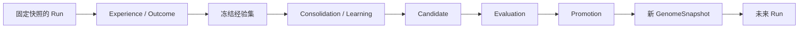

# 自进化、巩固与协作继承

当前实现包括能力/裁判/策略候选、冻结验证计划、学习队列、独立评估与显式晋升，以及团队版本继承。规则/LLM 本体决策实验报告与 Candidate 评估是不同证据，不会自动产生晋升授权。阶段状态见 [路线图](./roadmap.md)。

ProteusOS 的自进化是：同一 Organism 从多次任务的经验中提出变化，经独立评估后保留可复用结构，并让未来运行使用这些结构。是否“变好”必须限定任务分布、环境、约束和预算；生成更多内容、完成一次任务或多个 Agent 同时工作，都不足以证明进化。

## 1. 哪些东西可以改变

Kernel 维护身份、权限、不可变记录和晋升协议；主要演化对象是其上运行的 ArtifactVersion 组合。Organism 保持身份连续性，通过更新默认 GenomeSnapshot 改变后续行为。

当前可替换对象包含 task-graph、routing-policy、acceptance-evaluator、decision-view 与 capability 槽位。能力由独立构建与验收提出，策略由冻结开发经验归纳，裁判变化必须单独评估。Kernel、持久化格式与授权规则通过软件发布和迁移更新，不参加运行时自动演化。

运行中上下文不是可继承规则；要影响后续 Run 必须产生精确版本、候选与晋升。通用模型微调、架构演化与自适应路由权重未实现。

## 2. 演化的最小闭环

闭环包含三个独立责任：variation 产生变化，selection 用证据选择，retention 保存经过选择的版本与采用关系。



当前候选来自外部编码构建、规则归纳或受控 LLM 提议。一次经验可以触发候选提议，但不能因为“这次有效”直接成为长期策略。候选可以只改变一个 Skill，也可以提出一组相互依赖的版本；后者必须作为完整快照评估。

Selection 使用预先确定的约束、基线与评估集。Retention 保留精确版本、来源、证据及采用记录；未被采用的候选仍可留下审计记录。保留候选不等于激活候选，保存到仓库也不等于允许执行其代码。

评估通过独立授权的 evaluation Run 显式绑定候选或基线 GenomeSnapshot，无需提前更改 activeGenome。评估计划固定任务输入、裁判与资源范围；候选运行只控制受测行为。该路径与普通 Run 共用执行合同，但不获得默认行为选择权。

## 3. 在线执行与离线学习

在线路径负责决策、执行与结果记录。DecisionProvider 提供推断，不通过同一个 Interface 原地训练或覆盖正在服务的模型。

离线路径从冻结的经验集出发，执行整理、去重、模式提取、假设生成、候选构建和评估。Consolidation 产出新的 ArtifactVersion 与 Candidate，不直接更新 Organism 的 activeGenome。

“离线”是与在线执行的版本和权限隔离，不要求整个系统休眠。Consolidation 可以与用户 Run 并行，并受独立队列、预算与取消策略约束；它只读取一个已确定的经验窗口，后续经验留给下一轮。

Evolution Module 的 Interface 应隐藏数据切片、评估编排与记录关联的复杂性，向调用者提供候选提交、评估请求和晋升请求等少量操作。其 Interface 包含权限、幂等、版本前置条件和失败语义，不能只是一组方法签名。详见 [系统架构](./architecture.md) 与 [仓库设计](./repository.md)。

## 4. 不可变版本与运行快照

ArtifactVersion 的内容、内容引用、来源和 parents 在创建后不可修改。补充证据以独立记录关联，不能覆盖版本原有来源。Lineage 是有所有者和治理规则的版本家族；parents 可以引用其他 Lineage 的精确版本，形成可追溯的 DAG。

GenomeSnapshot 是不可变的 ArtifactVersion 精确引用集，包含运行需要的完整依赖闭包。不能在执行时把 `latest`、可变标签或上游当前版本解析成隐含依赖。来源指向远程模型时，记录可获得的版本标识及无法固定的部分，不能承诺完全可重现。

Task 是任务目标；Run 是一次完整任务执行；Process 是 Run 内的执行单元，可能委托给外部 Agent session；Attempt 是某个 Process 的一次执行尝试。每个 Run 创建时绑定一个 GenomeSnapshot，Process 和重试均沿用该快照。

Organism 的 `activeGenome` 指向供新 Run 使用的默认快照，并带有单调递增的 `revision`。已启动 Run 不随指针变化。恢复使用原快照；若必须采用新版本，创建新 Run 并关联原 Run，而不是把恢复伪装成同一次执行。详见 [运行时设计](./runtime.md)。

运行中的计划和上下文仍可变化；这些变化属于运行状态。快照固定的是可继承结构，不意味着每个行动或上下文都预先确定。

## 5. Candidate、Evaluation、Promotion 分别记录

| 记录 | 必须表达的事实 |
| --- | --- |
| Candidate | 目标 Organism、基准快照与 revision、候选快照、变更动机、来源经验集与引用、提出者 |
| Evaluation | Candidate、基线快照、协议摘要、评估 Run 引用与结果、数据集引用、汇总指标与结论；裁判由计划和 Run 固定 |
| Promotion | 目标 Organism、旧/新快照、预期/实际 revision、采用的 Evaluation、授权依据、操作者、提交结果与时间 |

这些记录不能合并为 ArtifactVersion 上的 `status`。Candidate 的待评估、拒绝或可晋升状态来自记录投影；`active` 是 Organism 与快照的采用关系，同一版本可以在一个 Organism 中活跃、在另一个中未采用。

一份 Evaluation 只能证明其记录范围内的结果。晋升时仍要检查权限、依赖闭包、基准是否过期以及所需评估是否齐全。评估完成不等于自动授权晋升。

晋升由 operator 显式调用，最新评估必须 eligible；自动晋升未实现。

## 6. 评估设计与裁判独立性

评估应在生成候选前确定任务范围、基线、主要指标、不可退化约束和预算。先检查有效性、权限、资源上限与兼容性，再比较任务质量、成功率、延迟、成本、重试和用户纠正等指标；不把所有约束压缩成一个可互相抵消的分数。

最低证据要求包括：

1. 固定独立基线与评估协议版本；新候选和基线在可比较的环境中运行。
2. 将经验中的训练/开发样本与 held-out 验证样本分开，记录来源，避免只测试已经生成答案的任务。
3. 对有随机性的任务重复运行，保留每次结果、失败和方差，记录可用的随机种子与执行器版本。
4. 同时检查目标改善与既有能力回归；覆盖失败样本和预算耗尽，不能只筛选成功日志。
5. 预先限制候选数量、评估调用、资源消耗和停止条件；证据不足时给出“不确定”，不能把评估预算耗尽记为通过。

样本数、最低收益和容忍区间取决于任务与噪声，作为评估协议的参数显式记录；当前不规定一个适用于所有 Artifact 的数值。多次查看同一 held-out 集会使其变成开发反馈，需跟踪使用次数并定期补充独立验证集。

Candidate 可以建议新的评估器或 benchmark，但不能用自己修改的裁判作为唯一晋升依据。评估器候选须由既有独立规则、保留的验证集与 operator 审查验收；裁判与被评估行为同时变化时，拆分为不同候选或固定其中一方进行对照。

原始输出和外部代码属于待检验输入，不能改变评估器的权限、验收条件或事实记录。对于会产生外部副作用的评估，使用隔离环境、受控测试对象或无副作用替身；shadow 执行也不能无条件复制真实写操作。

历史 replay 可以重建决策上下文并检验某些性质，但不能凭一段日志证明“另一个行动一定更好”。外部环境和模型可能已变化，反事实判断需要可比实验或明确标注的推断。

## 7. Generation barrier 与并发晋升

Generation barrier 固定本轮经验窗口、评估 cohort、候选依赖、基线快照和目标 revision。在线 Run 可以继续完成任务并产生下一轮经验；不需要暂停整个系统，也不需要等待所有 Organism 同时进入下一代。

晋升是一次对目标 Organism 的条件更新：仅当当前 `activeGenome` 与 `revision` 仍等于 Evaluation 绑定的基准时，原子写入新快照引用、递增 revision 并记录成功的 Promotion。状态更新与成功记录必须一起提交；调用重试使用幂等标识，不能重复晋升。

```text
Organism: G12 / revision 12
  Candidate A 基于 G12 → 评估通过 → CAS 成功 → G13 / revision 13
  Candidate B 基于 G12 → 评估通过 → CAS 冲突 → stale
  新 Run 绑定 G13；原 Run 仍绑定 G12
```

B 不能因“只修改另一个 Skill”就自动覆盖 A。它必须基于 G13 重新构造候选快照，检查依赖并重新评估组合效果；旧候选和旧 Evaluation 保留。可复用的测试结果须有明确适用条件，不能把旧晋升结论直接搬到新基准。

revision 用于识别 G12 → G13 → G12 的变化过程，即使回滚后快照引用相同，也不能让旧的并发晋升请求意外成功。跨 Organism 的采用独立提交，不引入一个全局“代号”或全局锁。

## 8. 回滚与故障处理

回滚选择一个历史已验证快照，通过同样的权限检查和 CAS 协议生成新的 Promotion，并将其标记为回滚操作。保留坏版本、评估证据和事故记录；回滚不篡改历史，也不把 revision 倒退。

回滚默认只影响未来 Run。已经启动的 Run 继续使用原快照；需要停止时由显式取消流程处理。必要时用旧快照创建恢复任务，而不是热替换运行中依赖。

回滚版本不会撤销已经发送的消息、修改的外部文件、提交的交易或其他副作用。补偿需要单独的授权、执行与审计；没有可靠补偿时必须把未恢复的外部状态明确记录。

进程崩溃、预算耗尽、数据损坏或评估失败都不能留下半激活快照。若已提交成功但响应丢失，调用者按幂等标识查询已有记录；若未提交成功，继续使用原默认快照。

## 9. Experience 与 Evidence

Experience 保存 Run 的终态、验收、输出摘要、耗时、Attempt 数和 decisionCallIds；通过 Run/Task/事件引用还原行为来源。开发窗口只包含本个体 normal Run，评估经历不得重新包装为开发材料。冻结成员用途不可任意改写，缺失或摘要漂移时拒绝读取。

一次成功只能支持其记录范围内的主张。当前未实现通用 Credit 或因果归因；规则学习按支持数与精度重算提议，未知成本保持 null。

## 10. 团队共享、继承与主权

多个 Process 并行工作可以为同一 Organism 积累经验。多个 Organism 合作完成任务，也不自动意味着共进化；只有合作经验进入各自候选、评估和版本采用过程后，才发生可追溯的长期改变。

团队作为独立的发布与治理 Scope 管理自己的 Lineage。个人默认快照不直接追随团队当前版本；团队发布也不会自动修改成员的私有经验或策略。

共享协议保留四种明确操作：

| 操作 | 含义 | 是否改变接收方运行行为 |
| --- | --- | --- |
| publication | 将精确版本、依赖与允许公开的证据发布到指定 Scope | 否 |
| import | 接收并校验版本、来源与依赖，保留为本地可评估内容 | 否 |
| fork | 创建由接收方治理的 Lineage，parents 保留原版本来源 | 否 |
| inherit | 在本地候选中选择版本，经本地评估与晋升后采用 | 仅影响晋升后的新 Run |

个人可以采用、拒绝、延迟或在 fork 后调整团队版本。父版本来自多个 Lineage 的组合也只是新候选，不因来源可信而免除评估。团队“通过”描述团队环境，不能替代个人目标、能力授权和环境下的验收。

私有经验、提示、凭据、用户偏好与原始任务内容不默认随 Artifact 发布。发布者明确选择共享内容与 Scope，记录必要的过滤与来源限制；接收方仍把外部内容视为待验证数据。团队评估可共享汇总证据，但汇总本身也需要检查是否泄露私有信息。

签名包在接收方本地登记公钥后验签，网络 registry 还检查团队凭据。来源撤信会阻止新导入、继承、评估与首次晋升，不自动回滚已采用行为。详见 [共享使用说明](./sharing-registry.md)。

## 11. 当前学习与验证规则

- `dataset-freeze` 固定 development 经验投影；`consolidate` 或队列作业只读取该投影。LLM 提议也必须按开发证据重算支持数/精度，零提议是正常结果。
- 非零策略候选生成前须 `validation-register` 注册未使用的本地计划，固定 case/family、输入内容树、schema/期望输出、回归角色、预算、重复数与门槛。
- 策略候选仅替换 routing-policy；图、能力、视图和裁判保持固定。验证 family 不可与开发窗口混用，已使用 family 不能重新注册为未见数据。语义家族归类由实验负责人保证。
- 双臂 × case × repeat 记录成功率、路由准确率、弃权率、时延及重复方差；不足样本或健康基线回归失败记 inconclusive，候选回归失败或标注路由不符记 rejected。
- 正式验证集只领用一次，同候选重试只读回既有评估；输入、门槛或计划摘要变化拒绝执行。
- 学习模型调用默认每个体累计最多 100 次，可显式调整。超时、取消及未知结果保留 unknown 和已用额度，迟到结果不生成候选。
- 学习队列支持运行中取消；停止其他 worker 后可显式恢复崩溃作业，未知外部调用不自动重发。
- normal/evaluation 预算池独立；导入能力代码要求真实隔离后端，固定 fixture 工程验收不能代替真实隔离或模型收益结论。

实现理由见 [ADR 0008](./adr/0008-m3-experience-driven-evolution.md)、[ADR 0009](./adr/0009-m4-selective-local-sharing.md) 与 [ADR 0010](./adr/0010-signed-sharing-and-registry.md)。
