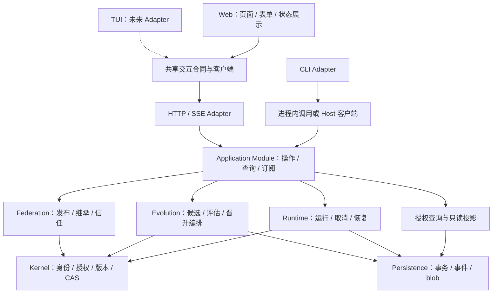

# 应用交互 Interface 与 Web 界面

日期：2026-10-10。产品偏好：**Web 优先**；保留 CLI，未来 TUI 复用相同应用 Interface。本文确定设计与实施顺序，Web、长驻应用 Host 和统一交互合同尚未实现；已有 HTTP registry 只承担版本交换。

## 1. 界面的职责与抽象位置

Web 承担个体管理、任务操作、执行观察、证据阅读、学习管理和版本采用。用户能够在同一入口回答：现在运行什么、为什么选择它、实际结果怎样、哪些行为改变了、依据是什么，以及能否取消或回滚。

抽象点放在 **Application Module 的 Interface**：它提供有类型的应用操作、查询和订阅，封装身份检查、实例生命周期、事务组合、幂等和错误语义。Web、CLI、未来 TUI 是调用这一 Interface 的 Adapter，各自组织导航、表单和展示。页面布局、终端绘制与 CSS 由具体 Adapter 实现，无需统一渲染 DSL。



图为目标结构。Application Module 组织用例，核心规则继续由各领域 Module 判定。UI 展示服务器给出的允许动作与原因；服务器执行时再次检查。前端不能直接写数据库、切换 activeGenome、调用模型或把模型的 allow 当授权。

统一交互 Interface 的必要性已经存在：现有 CLI 与新增 Web 是两个实际消费者。该工作不要求同时实现 TUI，也不要求将每个领域类型包装成新的通用框架。

## 2. 当前实现需要调整的地方

| 当前代码 | Web 接入所需变化 |
| --- | --- |
| [commands.ts](../src/app/commands.ts) 与 sharing-commands 混合解析、openInstance、业务操作、console 输出和关闭实例 | 抽出返回结构化结果的应用用例，CLI Adapter 保留参数与文字输出 |
| [instance.ts](../src/app/instance.ts) 每次命令打开实例，按 actor/organism 组装依赖 | 长驻 Host 拥有实例资源；请求绑定受信身份和明确个体，领域上下文不得跨请求串用 |
| [Runtime.submitTask](../src/runtime/index.ts) 创建并持久化 Run 后内联执行 | 拆开受控准入与后台执行：持久化 Task/Run、操作映射及调度事实后返回，原 CLI 可继续等待终态 |
| [事件合同](../src/runtime/types.ts) 的 seq 按 stream 分配；[查询](../src/storage/store.ts) 是内部 listEvents | 新增授权分页与可恢复订阅投影；不能将某个 stream 的 seq 当全局游标 |
| 当前 CLI 的 `--actor` 是本地受信身份声明 | HTTP 身份从 Host 会话确定，浏览器传来的 actorId 不授予权限 |
| [HTTP registry](../src/federation/registry.ts) 提供精确版本交换 | 复用 HTTP 工程经验，Web 的操作与查询合同独立设计；registry 凭据不自动成为用户操作授权 |

变化优先围绕 Interface 完成，迁移一条用例时同时改 CLI 调用与 Web 调用。领域流程不复制到 HTTP handler，也不通过子进程运行 CLI、解析 stdout 来驱动页面。

## 3. 第一版 Web 的信息结构

首版为本地单用户使用，默认一个 Organism，可切换已有且有权读取的个体。每页显示目标个体、连接状态和数据更新时间；进行写操作时固定该目标，不因切换页面而改写在途请求。

| 页面 | 核心内容 | 操作与验收 |
| --- | --- | --- |
| 个体总览 | 身份、当前快照/revision、能力、预算、运行中任务、待处理候选 | 显示真实状态与未知项；初始化已有实例或选择个体 |
| 任务与运行 | 目标、输入、验收、预算；运行列表与 DAG、Process/Attempt、日志、结果 | 提交、显式取消、查看等待/失败原因、接替任务；刷新后还能找到原 Run |
| 决策证据 | 受限视图、选项、Provider/模型/策略、选择、弃权、异常、时延/成本 | 现有规则/LLM 先展示；Jev 完成后增加真实分布和校准证据，缺失不补成 0 或概率 1 |
| 进化与采用 | 冻结经验、学习作业、Candidate diff、独立 Evaluation、回归与成本 | 提交/取消学习、评价、明确批准晋升、回滚；分别显示 evidence eligible 与实际采用 |
| 产物与谱系 | 版本内容、依赖、parents、快照绑定、来源与采用历史 | 读取获授权产物；导入/继承按现有固定版本流程进行 |
| 配置与权限 | Provider 是否可用、实例/工作区范围、预算、团队与来源信任 | 首版显示并管理已有能力；凭据由 Host 受控配置，不向浏览器返回明文 |

U1 先交付总览、任务提交、运行详情/取消和基本版本读取；U2 再交付学习、评价、晋升/回滚及分享管理。暂未实现的 Jev/Prediction/Memory 功能显示明确状态，只在相关后端合同完成后启用对应操作。

任务输入沿用目标、输入、约束和验收四要素。首版先支持固定任务模板和明确选择的输入资源；后续增加对话式草拟 Task 时，用户仍能查看并确认预算与验收。自然语言输入不自动扩大工具、权限或学习范围。

## 4. 应用 Interface 合同

按任务、演化和共享三个用例 Module 组织，避免把任意字符串命令与数据库 CRUD 暴露给前端。下面是拟议合同范围，名称和路径须在实现时冻结，当前不是已有调用方法。

| 用例 Module | 写操作 | 查询 |
| --- | --- | --- |
| Tasks | submit、cancel、supersede；显式 recovery/reconcile | 个体概要、任务/Run 分页、运行详情、授权日志和结果 |
| Evolution | 冻结经验、学习作业提交/取消、评估、promote、rollback | Candidate diff、Evaluation、学习状态、采用历史 |
| Sharing | 导入、fork、inherit、拒绝、发布与撤销 | 产物/谱系/发布、来源信任、团队权限 |

各 Module 返回版本化 DTO 与统一的操作回执，并复用少量查询/订阅基础合同。领域 ID 和精确版本保留；内部 Storage、SDK 对象、句柄和 Node.js 类型不进入浏览器合同。

### 4.1 身份、输入与允许动作

受信 `AppContext` 包含 actor、Organism 和会话/请求关联；Host 验证身份，Application Module 验证目标访问。UI 可以选择有权操作的 Organism，不能仅靠请求中的 actor 名称模拟他人。每次查询、订阅和写操作都检查当前权限，撤权后终止相关流并停止新动作。

浏览器以资源 ID 提交输入、输出 schema 和期望输出引用。Host 将它们解析为获得许可的文件/目录或上传内容，记录摘要，再按既有 Runtime 合同执行。资源解析检查授权范围与 symlink 真实路径；浏览器不能提交任意宿主路径、shell 命令、数据库位置或源码入口。

首版允许本地 Host 上明确授权的项目目录，以及有大小/类型限制的上传。模板中的固定裁判和测试命令由服务器登记；客户端提交任务数据，不获得任意修改裁判或执行命令的入口。

### 4.2 写操作与幂等

用户提交写操作时提供请求标识；Application Module 将其绑定 actor、Organism、操作类型与规范化内容摘要。相同标识和内容返回同一回执；标识相同但内容不同返回冲突。标识不是授权证明。

回执至少包含 `operationId`、目标对象 ID、已接受状态、查询位置和关联记录。长操作在 Task/Run/作业与操作映射持久化、授权和预算准入完成后返回 accepted；accepted 不表示任务成功。命令结果未知时查询同一操作，不能在页面重试时创建第二个 Run 或第二次模型调用。

promote/rollback 明确绑定候选或历史目标快照、所采用证据、预期 revision 和操作者意图。提交后由现有领域 Module 检查 eligible、权限、证据适用性与 CAS。页面过时收到 stale/conflict，刷新最新状态供用户重新选择，不能静默换一个 revision 重试。

取消返回“请求已接受”和实际终态的区别；已发送未知请求保留 unknown。浏览器断开连接只结束观察，不隐式取消执行。需要停止由显式取消动作触发，继续沿用现有预算、撤权与迟到响应规则。

### 4.3 查询与事件订阅

查询返回受授权 DTO、分页游标和观测版本/时间；授权日志、结果和 blob 单独获取，限制大小，不把原始数据库行或整个私有经验窗口默认送到页面。

首期采用 **HTTP 命令/查询 + SSE 状态订阅**。浏览器的实时变化主要来自服务器；SSE 支持事件 ID 与重连，适合这一阶段。[事件机制](https://developer.mozilla.org/en-US/docs/Web/API/Server-sent_events/Using_server-sent_events)

应用合同是 `snapshot + cursor` 与 `watch(scope, cursor)`；SSE 是 Web Adapter 的传输实现。CLI 可以轮询或使用同一订阅，未来 TUI 复用同一合同。未来出现需要双向会话流的具体需求，再增加对应 Adapter，不改领域事件语义。

初始快照与游标从一致存储视图取得，后续从该游标补齐事件，避免先查状态后订阅的丢失窗口。公开游标由服务器生成，包含作用域和所需的 stream 位置；当前 seq 是每流序号，不能直接充当全局序号。

通知允许重复，客户端按事件 ID 去重；不保证传输恰好一次。断线携带游标继续，过期游标返回 reset-required 并重新读快照。慢客户端超过缓冲限制时断开后重同步，不能阻塞 Runtime 或无限保存内存队列。事件携带对象 ID/观测版本，页面按需重查权威状态，不自行推演晋升结果。

### 4.4 错误与功能可用性

明确区分 not-found、forbidden、invalid-input、budget-exceeded、stale/conflict、unsupported、unavailable、unknown。HTTP 状态是传输映射，领域原因保留在结构化响应；缺失权限时不泄露不可读对象细节。

查询提供允许动作及不可用原因：例如候选未评估、证据不足、基线过期、服务未配置。界面可提前禁止无效操作，服务器执行时仍重新检查。模型未配置、真实收益未证明或证据缺失各有独立状态。

## 5. 本地长驻 Host 与现有 CLI

首版采用 **一个本地应用 Host 管理一个实例**，默认只监听 loopback，提供前端静态内容与同源 HTTP/SSE。它持有实例资源、后台运行调度和订阅生命周期；浏览器不成为运行所有者。跨域访问与写操作来源严格限定，浏览器会话使用 Host 登记的身份；后续远端/多人接入另立认证与部署方案。

Host 持有实例级独占锁，防止多个控制进程同时派发同一实例的外部工作。锁生命周期与本地进程关联，重启核对原持有者；不能因为连接失败就绕过锁。SQLite 的事务单 writer 保护记账，但不替代后台执行所有权。

Host 运行时，同一实例的 CLI 写操作通过同一 Host/应用 Interface；Host 不运行时，保留 CLI 进程内调用模式，并获得相同的实例运行所有权。连接失败明确报告，不自动降级启动第二个 writer/runner。无头批处理仍可使用相同应用用例。

当前 Runtime 提交会内联执行，应先将“事务准入并创建 Run”和“执行已创建 Run”拆为受控操作。Application Module 将回执映射与待运行事实一致保存，然后由 Host 调度，不能仅以未持久化的后台 Promise 支撑 202 响应。准入时的预算预留和截止点继续有效，排队或恢复不会重新给足预算。

Host 启动后按现有记录恢复：已确认结果读回，未知外部调用保留 unknown，由授权恢复/对账流程处理；浏览器刷新不会造成重派。停止 Host 时停止新准入并记录在途状态、传播允许的取消；不能以进程结束证明远端未执行或费用为零。

AppInstance 目前按 actor/Organism 装配 Runtime/Evolution。长驻 Host 可共享 Storage/Kernel 等资源，但每个用例的 actor/Organism 上下文明确绑定；不得修改一个共享实例的“当前用户/个体”来服务多个请求。浏览器关闭不调用全局 instance.close，资源由 Host 生命周期统一释放。

## 6. 首期技术选择与目录

设计基线采用 **TypeScript + React + Vite 的浏览器客户端，现有 Node.js 控制面提供 HTTP/SSE**。这是本地操作界面，服务器已有领域和持久化实现；首期不需要搜索引擎收录或服务端页面渲染。React 官方列出 Vite 作为客户端构建方案，Vite 提供开发和静态构建能力；具体依赖版本实施时锁定。[React 构建说明](https://react.dev/learn/build-a-react-app-from-scratch)、[Vite](https://vite.dev/guide/)

保持现有单仓库与领域目录，按实际职责增量增加：

```text
src/app/
  contracts/             # 可被浏览器导入的纯 DTO / schema / 操作与订阅合同
  use-cases/             # 任务 / 演化 / 共享应用用例，返回结构化结果
  host/                  # 实例所有权、生命周期、后台调度、恢复
  http/                  # HTTP / SSE Adapter：身份、解析、映射与静态资源
  cli.ts                 # 既有 CLI Adapter：参数和终端输出
  commands.ts            # 迁移期间保留，逐用例调用新的 Interface
web/
  src/                   # 页面、UI 状态、客户端 Adapter
```

以上目录为规划，不创建空源码包。`web` 出现独立构建需求后作为工作区项目管理；根领域代码无需因此拆成多个包。共享合同独立于 React/Node 实现；前端不能导入 Runtime、Storage、Kernel 或 SDK。应用客户端缓存只用于展示，服务端记录始终是权威状态。

## 7. 排期、交付与验收

界面作为 **U 工作线**，与 M5 决策层配合；U0 先行，U1 在 M5 期间交付，U2 随既有演化流程补齐，JeV/后续学习展示跟随后端合同。以单开发者计，工期要计入总体排队，不能把两条线都承诺为同一时间内完成。

| 切片 | 建议投入 | 交付 | 完成判据 |
| --- | --- | --- | --- |
| U0：应用 Interface 与 Host | 1–2 周 | 提交/查询/取消用例、结构化回执、实例所有权、持久化后台准入、CLI 复用 | 同一用例跨 CLI/HTTP 行为一致；响应丢失与刷新不重复执行 |
| U1：可用 Web 基础 | 1 周 | 总览、任务提交、Run DAG/事件/结果、显式取消、基本版本查看 | 浏览器完成提交→观察→验收闭环；刷新/重连恢复；真实权限/预算生效 |
| U2：学习与版本治理 | 1 周 | 作业、候选 diff、Evaluation、晋升/回滚与采用历史 | 同 revision 并发晋升只有一个成功；页面过期不会借新证据自动通过 |
| U3：决策与协作深化 | 后续按需 | Jev 分布/校准、预测偏差、记忆引用与共享操作 | 后端能力可用时才启用；私有数据、实验用途与授权约束保留 |

第一批实施顺序是：提取现有 submit/runs/cancel 应用用例 → 增加 Host/HTTP 与持久化提交 → 建立订阅 → 完成 U1 页面 → 补齐 U2。Web 研发无需等待 Jev 真实收益或全部 M6 学习能力。

实施检查包括应用合同、HTTP 解析/身份、真实 SQLite 恢复、分页/游标、断线/重复通知、跨个体访问拒绝，以及浏览器端的真实提交、取消与晋升故事。复用现有 Kernel/Runtime/Evolution 检查，不把前端模拟数据当作整体已接通；源码检查和必要前端构建纳入 `pnpm check`。

用户可见的首个交付是：打开本地 Web，选择个体，提交一个有输入/预算/验收的任务，观察图中各步和决策来源，查看真实结果；之后能够查看候选比较并明确采用或回滚。TUI 是否实施由后续使用需求决定，应用 Interface 已为其保留复用路径。
