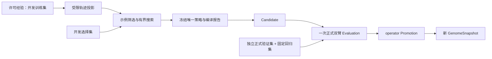

# 后续迭代规划：可替换决策层与经验驱动适应

日期：2026-10-10。依据：[原始架构讨论](thread://01a0be11-a5e0-7f71-aab1-4755bc2cd30c)、[DSPy 论文](https://arxiv.org/pdf/2310.03714)、[Jev 官方资料](https://docs.typesafe.ai/api)及当前工作区；源码基线为 `2ed664c`，文档整理同步至 `2b0788d`。本文件修正上一版只围绕行为编译排期的范围：先补 Jev/可替换决策层，再实施更完整的经验适应。M5–M8 均未实现，不改变已冻结实验协议。

2026-10-23 执行细化：结合 [Harness² 与 DSPy 联合分析](./research/dspy-harness2.md)，将 M6 分为策略编译、任务内适应和改进经验库三个切片。具体依赖、验收与最新执行状态集中记录在 [执行计划](./execution-plan.md)；新增范围按切片重新估算，不直接沿用下文原 M6 的整体工期估计。

## 1. 本轮收敛的方向

**接下来优先补齐可替换的 Decision/Policy 层，让 Jev 进入已有运行与证据闭环；随后验证同一个体能否通过预测、观测、经验回放与离线学习，在新任务上改进行为。** DSPy 是其中一种参数优化方法。原始讨论中的生成、选择、执行分工，以及身份、可继承结构和多时间尺度变化仍是架构主轴；完整核对见 [原始架构差距](./architecture-gaps.md)。

产品路径以个人长期使用为起点：**Web 为优先交互入口**，CLI 保留，未来 TUI 共用 Application Interface。新增 U 工作线近期交付操作、查询、订阅与真实页面，不等待研究功能全部完成。详见 [应用交互与 Web](./interaction.md)。

采用以下顺序：

1. **P0：差距与证据基线。** 核对原架构、Jev 服务可用性和现有规则/LLM 实验；冻结新的决策层实验，不往 v1 偷加 Jev 臂。
2. **M5：可替换决策层。** 先实现 Jev choice、类型化概率证据和独立效果比较；校准后再增加 binary/score 或有界级联。现有 Provider 接口和名称注册表继续复用。
3. **M6：经验驱动适应。** 关联 Prediction/Outcome、许可 replay 与事实自我投影，扩展离线学习合同。对具有实际改进空间的策略开展受控编译，输出冻结候选并独立评价。
4. **M7：有限多模块流程。** 在单个体适应有收益后，扩展固定模块组合；Memory 检索、Skill 蒸馏按任务需求选择实现与评价。
5. **M8：团队产物本地继承。** 在本地适应有收益后，复用已有签名与 registry，让接收方重新评估、选择或适配团队产物。

交互工作独立排队：**U0** 提取应用用例与长驻 Host，**U1** 完成任务/运行 Web，**U2** 完成学习与版本治理，**U3** 跟进 Jev/预测/协作展示。它贯穿 M5–M8，属于软件与产品交付，不作为可继承行为候选自我修改。

模型微调、自动晋升、动态图、学习式世界/自我模型、元可塑性、大规模联邦和共进化继续作为独立研究。基于真实记录的能力/失败/资源投影与最小预测观测闭环进入 M6；它们无需等完整世界模型。生产 registry 部署由真实协作需求触发；真实数据保留、删除与可训练用途治理是接入私有任务经验的前置。

## 2. 原始架构、Jev 与 DSPy 的关系

原始讨论以持续个体与可继承产物为中心，要求生成方案、结构化选择和受控执行分开；Jev、本地分类器或小模型是在线 DecisionProvider 的替换实现。当前 Jev 官方接口提供 Choice、Score、Noul；概率证据、阈值校准与本项目 gate/rank 的派生规则需要宿主单独实现。Serving 与 Learning 保持分离，Jev 本身不提供客户微调。来源与接入边界见 [Jev 研究笔记](./research/jev-decision-plane.md)。

DSPy 把行为描述、模块组合与参数优化分开；其编译过程利用经过指标筛选的调用轨迹构造示例，并在开发评价中选择参数。借鉴点来自论文 §3–4，研究核对见 [论文笔记](./research/dspy-paper.md)。本项目据此提出下面的工程映射，属于规划推断，而非论文对 ProteusOS 的实验结论。

| 论文中的概念 | ProteusOS 的对应落点 | 需要补齐的部分 |
| --- | --- | --- |
| Signature | Decision 的输入、有限选项、响应与弃权合同 | 把行为语义和固定 schema 显式版本化，分离可优化参数 |
| Module / Program | 固定 DAG 节点、DecisionProvider、Executor | 先复用路由模块；后续才增加模块间类型化数据传递 |
| 模块参数 | routing-policy 中的提示、示例与模型配置 | 首期开放示例集合和顺序，冻结模型、指令与格式适配器 |
| 调用轨迹 | DecisionCall、Run、Attempt、Experience | 提取经过独立验收的模块输入/输出投影，保留来源与用途 |
| Optimizer / 编译 | Consolidation 的有界候选搜索 | 引入优化器合同、开发选择集、搜索记录和编译报告 |
| 编译程序 | 不可变策略版本与 GenomeSnapshot | 通过 Candidate → Evaluation → operator Promotion 生效 |

ProteusOS 已有长期身份、预算恢复、权限、不可变快照及晋升治理；这些职责继续由现有模块负责。论文中的数学与问答收益不能直接推导为路由、编码任务或持续适应的收益。本文的阶段、门槛和实现选择均为本项目建议；不沿用论文的收益百分比。

对通用 LLM，可优化 instructions/demos；对 Jev，可在官方支持范围内优化 question/criteria 与受限状态表达；对本地可训练模型，后续可形成数据/权重候选；Memory、Skill 则有各自内容合同。这些都通过 Candidate/Evaluation/Promotion 治理，不强迫使用同一种 few-shot 格式。

## 3. 当前基础与真正的缺口

| 已核实的实现 | 对后续规划的含义 | 依据 |
| --- | --- | --- |
| M0–M4 和签名 registry 的工程闭环 | 下一阶段围绕效果验证，不再补一套版本/晋升系统 | [当前路线图](./roadmap.md)、[架构](./architecture.md) |
| DecisionProvider、名称注册表、规则与通用 LLM choice 已有；没有 Jev 实现 | 保留替换缝，先新增 Jev Adapter 与概率证据；不能将整个决策层标为完成 | [Decision](../src/decision/index.ts)、[装配](../src/app/instance.ts) |
| CLI 用例仍混合生命周期和终端输出；没有应用 Web | 提取共享 Application Interface、持久化异步提交与订阅；Web/CLI 复用，后续可接 TUI | [命令](../src/app/commands.ts)、[Web 设计](./interaction.md) |
| 当前没有独立 Prediction/Credit、通用 Memory 检索或统一自我事实投影 | 原架构尚有功能缺口；M6 先落实预测/观测与 replay，随后按任务扩展记忆/Skill | [领域模型](./domain-model.md)、[架构差距](./architecture-gaps.md) |
| `llm-choice-v1` 使用不可变的 `promptTemplate`、模型与采样配置 | 可以增量增加编译策略格式；保留旧策略解析和旧 Run 恢复 | [策略合同](../src/decision/llm-policy.ts)、[LLM Adapter](../src/adapters/decision-llm/index.ts) |
| 规则巩固与 LLM 提议最终都生成 `feature → choose` 规则 | 当前是在固定词表内归纳；尚无示例参数优化或多模块编译 | [规则巩固](../src/evolution/consolidation.ts)、[LLM 提议](../src/adapters/consolidation-llm/index.ts) |
| 完整调用与运行证据、冻结私有经验、学习作业与调用账本 | 复用来源、恢复、取消和预算机制；新增的是编译所需投影与搜索工作量 | [调用记录](../src/decision/call.ts)、[演化类型](../src/evolution/types.ts)、[演化实现](../src/evolution/index.ts) |
| 正式 ValidationSet 预注册、单候选绑定、一次领用、family 隔离 | 保留这些约束；多候选搜索另设开发选择集，不反复消费正式集 | [验证规则](./evolution.md#11-当前学习与验证规则) |
| 策略双臂评估包含成功率、路由、弃权、时延和重复方差；成本为 `null` | 扩展独立 family 样本量、明确弃权/异常分类和全生命周期成本 | [评估类型](../src/evolution/types.ts)、[策略评估](../src/evolution/index.ts) |
| 执行图支持有限 decision/execute/verify 节点 | DSPy 风格通用模块调用和任意控制流不是已有能力；M7 单独实施 | [图合同](../src/runtime/graph.ts) |
| 真实模型收益仍未验证 | 补齐证据才能决定复杂优化是否值得做；fake 结果只用于工程验收 | [实验协议与执行说明](./experiments/organism-decision-v1.md) |

这里“已核实”指源码与文档检查。本轮只整理规划，未重新执行测试、调用模型或获得新收益结果。

## 4. 实现路线选择

在线决策侧沿现有 `DecisionProvider` 接官方 Jev SDK/HTTP Adapter，凭据只在 app 注入；模型、问题、选项与阈值版本化。概率校验和校准合同由 Decision 拥有，级联与逐次调用恢复由 Runtime/宿主编排，不能藏进 SDK 自动重试。未来本地模型通过同一层接入。

下表只讨论 M6 的离线编译实现，不代替 M5 的在线决策接入：

| 路线 | 优点 | 代价与适用条件 | 选择 |
| --- | --- | --- | --- |
| TypeScript 内实现窄范围编译 | 原生复用权限、账本、快照和 choice 校验；依赖少 | 自行实现少量示例筛选和有界搜索，只承诺一个契约 | **M6 默认采用** |
| 隔离 Python worker 使用 DSPy | 可复用现成优化器，适合研究对照 | 需要跨语言合同、版本锁定及每次模型调用的宿主记账；导出的候选须重新验收 | 原生搜索遇到瓶颈时再作对照 |
| 将控制面整体迁移到 DSPy | 获得统一的 LM 编程接口 | 重做现有控制与恢复边界，缺少已证明的收益 | 当前不采用 |

默认方案只实现“给冻结经验和开发选择集，返回编译策略及证据”的小接口，不复制通用 DSPy 框架。DSPy 当前 API 与 2023 论文存在演进；若引入 worker，按当时的官方文档选定并锁定发布版本，记录软件与优化器版本。

ACP/pi 外部 Agent 目前是受托执行器。它们的私有内部提示和未公开轨迹不能算可优化参数；只有经 Adapter 明确暴露、可固定、可审计的输入输出才进入编译合同。

## 5. M5：先补齐 Jev 与决策平面

### 5.1 M5a：choice 接入与证据

在 `src/adapters/decision-jev/` 新增 Jev Adapter，问题/criteria 和模型配置保存为不可变策略内容。沿用同一受限视图、候选能力和固定裁判，先在现有 stats/changed-file-summary 场景比较规则、现有 LLM 与 Jev。新增 `decision-plane-v1` 协议与报告；不更改 `organism-decision-v1` 已冻结的两臂和门槛。

扩展 Decision 的类型化证据：保留供应商原始 probabilities/confidence、选项/量表标识、来源模型版本、用量、缺失值及方法；运行时独立校验数值范围、选项对应关系与分布一致性。模型返回一个合法选项不等于选择正确，更不等于获得执行权。

固定外部非执行类别或阈值弃权语义，分别记录正确弃权、误派、非法响应和传输异常。供应商 confidence 不自动代表经验正确率；阈值只在开发校准集上选择，并与策略共同冻结。首期关闭 SDK 自动重试，每个真实调用进入现有账本，恢复、撤权、取消与迟到响应沿用当前语义。

交付门为：现有 choice/旧快照兼容；真实 Jev 请求、模型版本与响应分布可追溯；预算和恢复不重复调用；独立 family 上端到端成功、误派、弃权、时延与成本可复算。没有可用凭据时明确真实接入 not_run，只能认定合同/fixture 工程通过。

### 5.2 M5b：校准与第二类决策

先评价 Jev 单 Provider 的分布质量、正确率与覆盖率关系；有独立校准资料时增加 Brier/可靠性分组等适用指标，不虚构分布或把不同问题量表混用。基于明确任务需要，再选择 binary 或 score 作为第二类合同，贯通图准入、结果校验、状态恢复、下游消费和独立评价。

Jev Noul 映射 P(true)，binary 的阈值是本地 Policy；Score 固定量表和取值含义。rank/gate/estimate 不一次性补齐，也不声明为 Jev 原生原语。规则 Adapter 的 allow/deny 分支不算完整 gate 运行；实际授权继续由 Kernel/Runtime 检查。

有界级联是后续独立切片：按固定 Policy 逐级执行规则 → Jev → LLM → 弃权/操作者处理，逐次建调用记录、累计预算并受整体截止时间约束。unknown 先结案或对账，不能自动升级制造重复计费。若单 Provider 已满足质量和成本目标，不为“层数齐全”增加级联。

本地开源模型保留同一合同和可获得的权重摘要，模型选型/推断宿主/训练预算另行冻结；Jev 接入不成为基质依赖，Jev 没有胜出也不取消可替换决策层方向。

## 6. M6：经验适应与受控编译

### 6.1 最小预测、回放与自我事实投影

先记录行动前可检验的预期：预计输出/验收条件、耗时或资源范围，并明确来源、适用条件与未知项。行动后关联真实 Outcome 和偏差。没有概率就不补概率，范围偏差不能伪装成精确因果归因。

从许可冻结窗口生成最小 replay 投影和 self-state：当前可用能力/版本、实际预算、按任务 family 的失败模式、已知限制与缺失证据。该投影从真实记录派生、带截止点，先供 inspect/离线学习使用；若要进入在线 decision-view，须作为独立版本变化评价，不能偷偷改变 M5 的比较输入。

历史回放先做无副作用的决策重算与受控用例，不再次执行历史外部写操作。先用单变量双臂比较建立限定范围的贡献证据；通用 Credit 和学习式世界模型继续后置。

扩展离线 PolicyLearner 合同以适配规则归纳、Jev question/criteria 搜索与通用 LLM 参数编译。Learner 只返回候选与证据，不写 active 指针、不修改裁判。下文是其中一条可实施的 LLM 示例编译实验；只有相应策略存在可改善空间时启动。

### 6.2 修改范围

本实验的首个契约为通用 LLM `route-choice`：输入沿用受限 decision-view 与固定 options，输出沿用合法选项或明确弃权。编译时只改变示例集合和排列；系统指令、输出 schema、选项、视图、执行能力、图、裁判、模型与采样条件全部冻结。受信格式适配器负责生成完整请求，编译器不能改写校验或权限规则。

M5 若选出的线上基线是 Jev，不为了执行 DSPy 实验强制改回通用 LLM。先分析 Jev 的失败是否来自问题/criteria 或状态表达；在官方接口支持范围内用同一受控搜索治理优化这些参数，另立实验协议。下述 few-shot 试验可作为 LLM 对照路线，收益不足时停在开发侧。

“Signature”描述语义与输入输出要求，不替代运行时 schema、成员关系校验或实际授权。M6 可将契约和参数作为新 routing-policy 格式的内容字段，继续使用现有 ArtifactVersion；有第二个消费者之后再决定独立模块产物格式。

同一正式评估的两臂只差编译策略版本。为减少评估成本，先在开发侧进行消融并选一个最终候选；正式阶段比较最终候选与冻结基线。已有规则基线、人工冻结提示和当前规则巩固作为开发对照；需要分别作正式收益主张时，须事前登记对应比较与新的证据计划。

### 6.3 数据与证据

开发训练集供示例生成和筛选，开发选择集供比较参数，正式验证集仅用于最终收益判断，固定回归集守住健康既有行为。按 family 整体分组；正式与开发 family 不重叠。回归集单列、不会被误计为新的泛化样本。M6 将开发集内部的 train/search 子分组及许可持久化，不直接改变已有 ValidationSet 的单次语义。

在搜索开始前冻结正式协议、预算、指标与验证计划；编译器只能看到其摘要，不能读取正式目标、标签或失败反馈。选出唯一策略后绑定正式 Candidate。正式结果暴露后，该批 family 只能转作回归；下一轮另备未见 family。

轨迹投影至少关联 `runId/nodeId/decisionId`、契约/策略/视图版本、实际输入输出引用、固定裁判、终态、用途及用量。候选示例须来自许可开发经验，并通过来源完整性、schema 和端到端验收；弃权示例须有独立标签支持。失败与 unknown 作为诊断证据保留，不自动变成正确示例。

成功任务的中间步骤也可能有错。M6 的单路由必须同时核对已知正确选项与最终验收；M7 再增加模块局部契约和交叉检查。只使用实际公开输出，不要求或采集隐藏思维链。

示例会把历史内容带到未来请求。接入真实私有经验前，须完成训练用途授权、最小化/脱敏、可导出范围、保留期与删除流程；首轮使用合成或明确许可资料。删除必须使受影响原文不可继续被检索或发送；既有快照不能绕过删除，证据标记不可回放，不以永久保留原文满足审计。

### 6.4 编译器合同与记录

输入为冻结基准快照、路由契约、训练/搜索分组摘要、优化器版本、示例限制、资源预算与停止条件。输出为零或一个待正式评估策略、编译报告和来源引用。零候选是有效结果。

搜索中的参数变体保存在私有编译记录中，不能生成可晋升证据。最终策略才进入现有 Candidate 流程。建议增加的记录如下，名称为拟议领域合同，并非现有 API：

| 记录 | 最少内容 |
| --- | --- |
| CompileJob | 基准 revision/快照、契约、分组/优化器摘要、调用与时间上限、取消状态 |
| CompileTrial | 参数变体摘要、示例来源、搜索集逐次结果、用量、失败/未知状态 |
| CompileReport | 全部试验数、选择规则、胜出原因、消融、生成/搜索成本、正式评估引用 |

预算涵盖轨迹生成、teacher 调用、参数搜索、执行器与评价调用。不能只给提议 LLM 记一次账，却漏掉几十次搜索调用。已发送未知调用保留费用风险，取消或崩溃不重置额度。恢复读回已确认记录；unknown 不自动补调。学习与正式评估继续使用分开的资源池，不占用普通任务保底预算。

首轮建议上限为 **8 个参数变体、每个最多 4 个示例、编译期最多 100 次真实模型调用**，全部 teacher/search 调用计入其中；搜索范围由额度反推，不能静默缩减已登记正式样本。额度不足可输出无候选或不完整搜索报告。数值是启动约束建议，必须在运行前结合样本量冻结，不是收益结论。

### 6.5 判断是否值得晋升

硬门包括：版本与来源完整、正式 family 未暴露、无越权派发、预算内完成、输出严格合法、健康基线回归成立、候选无预先指定的关键回归。时延与异常同样保留，不能从分母删除。模型弃权、服务拒绝、invalid_output、timeout、unknown 分开报告，不能把所有“没有选择”算正确弃权。

效果门在搜索前选择一种主目标，其他指标作为约束：

| 主目标 | 首轮建议门槛 | 附加条件 |
| --- | --- | --- |
| 质量提升 | 独立 family 上端到端成功率提升至少 5 个百分点 | 关键回归全过，成功任务平均已知成本增加不超过 20%，p95 满足原产品上限 |
| 降本 | 在成功率非劣界限为 2 个百分点时，成功任务平均成本下降至少 20% | 费用完整可核验，质量非劣与关键回归成立，计入编译成本摊销 |

这些是新实验的建议取舍，不能原地覆盖 `organism-decision-v1` 的 10 个百分点等已冻结门槛。样本量由最小有用差异、基线和独立 family 数决定；小型试跑只筛掉无效方向。重复次数用于估计随机性，不充当独立样本。采用按 family 聚合的配对差异与置信区间，方法、种子和决策规则事前固定；若区间无法支持主张，记 inconclusive。

质量主张建议要求差异点估计达门槛且区间下界大于零；降本主张要求质量差异区间下界不低于预设非劣界限，并满足成本门。正式样本量不足时，不以“100 次调用”或“每个 case 重复 3 次”宣称统计成立。

完整记录 `C_compile`、`C_formal_eval`、线上成功任务成本与适用任务量。成本目标下，若单次节省为正，估计摊销任务数：`N_break_even = (C_compile + C_formal_eval) / (C_baseline - C_candidate)`；同时列成功率和失败成本。价格/金额未知时只报告调用数、tokens 与未知项，不能宣称货币降本或摊销完成。

## 7. 阶段交付与推进门

以下工期按一名主要开发者估算，从开始实施起算；未计独立验证资料准备、凭据等待与服务排队。时间用于排队，效果门决定是否进入下一阶段。

| 阶段 | 估计投入 | 主要交付 | 推进门与未通过时的处理 |
| --- | --- | --- | --- |
| P0：差距与证据基线 | 1 周 | 现有 v1 真实报告状态；Jev 可用性/官方合同核对；新的 decision-plane-v1 数据、指标、预算与独立验证准备 | 无凭据明确 not_run；工程验证与模型收益分开，原 v1 不变 |
| U0：应用 Interface / Host | 1–2 周 | 提交/查询/取消用例、回执、持久化准入、实例所有权、CLI 复用 | CLI 与 HTTP 行为一致，断线/响应丢失不重复 Run 或调用 |
| U1：基础 Web | 1 周 | 个体总览、任务提交、运行 DAG/事件/结果、取消、基本版本查看 | 浏览器完成真实任务闭环；刷新/重连、权限与预算生效 |
| M5：Jev choice 与校准 | 2–3 周 | Jev Adapter、统一概率证据、固定弃权语义、调用账本/恢复、规则/LLM/Jev 对照和校准报告 | 真实接入可验证、约束门成立；Provider 选择根据收益，未胜出也保留替换能力 |
| M5 扩展：第二类决策/级联 | 另估 1–2 周，按需求 | binary 或 score 的完整图运行；有界升级 Policy 与逐跳账本 | 依赖 M5 校准与真实需求；若单 Provider 已足够，不增加级联 |
| M6a：预测、回放与数据 | 2 周 | Prediction/Outcome 关联、许可 replay、自我事实投影、学习契约、train/search 分组与旧格式兼容 | 预期先于观测保存、未知项不伪造，历史写操作不重放，formal 不可读 |
| M6b：编译与验证 | 2 周 | 确定性示例筛选、有界随机组合、编译队列账本、最终 Candidate、消融与正式报告 | 工程恢复/取消/预算通过，且正式效果门支持主张；失败保留记录，不晋升 |
| U2：学习与采用界面 | 1 周，可在 M6 前交付 | 学习作业、候选 diff、评价、显式晋升/回滚与历史 | 界面过期返回冲突，eligible 与已采用分开，实际 CAS 不绕过 |
| M7：固定多模块流程 | 2–3 周，M6 收益后启动 | 类型化模块数据传递、模块 trace、按需要加入 Memory 检索或 Skill 候选；分别/联合优化对照 | 相比单模块带来可复现收益；检索/Skill 使用自己的内容与评估合同 |
| M8：本地团队复用 | 1–2 周，M7 收益后启动 | 可共享编译产物、依赖检查、本地重新编译与独立继承比较 | 两个个体各自评估并采用/拒绝；零私有示例泄露；仅证明选择性复用，不宣称共进化 |

**近期承诺范围建议为 P0 + U0/U1 + M5 的 Jev choice/概率证据/校准。** 决策工作仍估 3–4 周，应用 Interface 与基础 Web 另估 2–3 周；一名主要开发者顺序执行约 5–7 周，不将两条线当作同一时间内自动完成。建议 P0/U0 先固定合同，随后按实际人员安排 M5 与 U1；U2 的已有演化治理页面可以在 M6 前交付。

M5 的第二类决策/级联另行估算，M6 的经验适应与编译约 4 周，后续按证据排队。现有规则/LLM 实验与 Jev 实验分别冻结；若规则已经接近上限，保持强基线，转向有用的成本/时延目标，不制造收益空间。

M7 可从“任务意图提取 → 有限路由选择”或“许可经验检索 → 有限路由选择”选择一个固定流程，先和直接路由比较，确认新增模块的价值。检索候选、引用、失效和删除有独立合同；Skill 则需有明确触发条件、输入输出、前置约束、来源与回归，经验摘要不直接当作已验证 Skill。不把结构化“意图”称为隐藏推理。模块稳定后才优化参数，图变化作为独立候选评估。自由生成计划、开放 Agent 循环和代码自修改不进入该阶段。

M8 先使用两个本地个体与现有离线包/loopback registry；外部示例集合必须明确批准且依赖可共享。默认发布策略、契约和非敏感汇总；私有训练原文与轨迹不随包交换。接收方可以依据本地经验重新编译，也可以拒绝。只有后续多轮相互改变学习分布并有独立证据，才讨论共进化。

## 8. 第一批可实施工作

近期先完成应用 Interface/Host 和 U1 Web（[交互实施切片](./interaction.md#7-排期交付与验收)），并推进下面 1–5 的 M5 决策层交付，再实施 6–9 的 M6 经验适应。接口名称与 CLI 在实现后写入执行说明，避免把拟议命令当作现有命令。

| 顺序 | 工作 | 主要落点 | 验收 |
| --- | --- | --- | --- |
| 1 | 核对原架构差距、现有实验状态、Jev 服务/SDK、模型可固定程度与调用额度 | `docs/`、`experiments/protocols/` | 本文差距矩阵与官方事实一致；无凭据不标真实完成 |
| 2 | 冻结 `decision-plane-v1` 协议与 typed choice 概率/弃权合同 | `docs/experiments/`、`src/decision/` | 规则/LLM/Jev 相同视图和裁判，开发校准/正式 family 分开，原 v1 不变 |
| 3 | 实现 Jev Adapter、策略解析、app 装配与证据存储 | `src/adapters/decision-jev/`、`src/decision/`、`src/app/`、`src/storage/` | 运行时校验响应，关闭隐式重试，凭据不落盘，旧策略兼容 |
| 4 | 贯通 Runtime 调用/取消/恢复与实验报告 | `src/runtime/`、`experiments/protocols/`、`tests/` | 并发预算、unknown、迟到响应、撤权不重复派发；分布/校准/成本可复算 |
| 5 | 独立真实比较并冻结 Provider 选择与阈值 | 授权实例、实验报告 | 真实兼容与收益分别结论；新快照使用需显式授权，不自动切换 |
| 6 | 最小 Prediction/Outcome、replay、self-state 投影及训练用途治理 | `src/runtime/`、`src/evolution/`、`src/storage/` | 行动前后有时间与版本来源；未知不伪造，删除/失效生效，无历史写重放 |
| 7 | 冻结 `behavior-compilation-v1` 并定义适用策略的学习合同与 train/search 分组 | `docs/experiments/`、`src/decision/`、`src/evolution/` | 明确 Jev criteria 或 LLM demos 的可变范围，formal 不可读，预注册效果门 |
| 8 | 有界搜索、账本、唯一 Candidate、正式评价和只读编译报告 | `src/evolution/`、`src/storage/`、`experiments/protocols/` | train/search 不产生 eligible；完整成本与来源，崩溃不重调模型 |
| 9 | 开发消融、冻结、独立正式验证；通过后显式晋升并试用 | `tests/`、授权实例、实验报告 | 新 Run 使用新快照，旧 Run 保持旧版本，回滚有效；证据不足不晋升 |

实现阶段按现有 unit/contract/integration/acceptance/evals 布局补充有意义的合同与故事，运行 `pnpm check`。日常 CI 使用 fake，只证明工程行为；真实实验单独执行，使用预先固定的额度。首期只优化策略、不生成能力代码；未来涉及生成/导入代码时继续满足现有真实隔离准入。

## 9. 停止、复盘和范围调整

每轮结束必须记录“是否有候选、证据是否完整、收益是否成立、是否授权采用”四个不同结果。无候选、收益不足或 inconclusive 都是正常产出，不强行晋升。

出现数据污染、基线失效、来源缺失、预算未知失控或服务配置漂移时停止本轮正式结论，保留证据并重新登记协议。看过正式结果后调整提示、示例或指标，必须使用新的验证 family。下一轮可以把旧结果用于回归与开发分析，但不能重复声称独立泛化。

同一窄任务连续两轮在预设资源内未获得有用提升时，复盘失败属于数据、模型、任务分布还是执行能力；有明确新假设才启动新协议。若搜索/编译成本无法在预期任务量内摊销，则缩小搜索、保留规则或人工策略。无论结论如何，都不以扩展模型权限、增加自由循环或降低裁判标准作为默认补救。

最终希望得到的证据是：某个 Organism 因许可的历史经历形成精确行为版本，在新的任务 family 上获得可重复的改善，以可解释成本保留该版本；另一个个体能在自己的约束下独立验证和选择继承。达到这一点之后，再投入更长期的适应与共进化研究。
