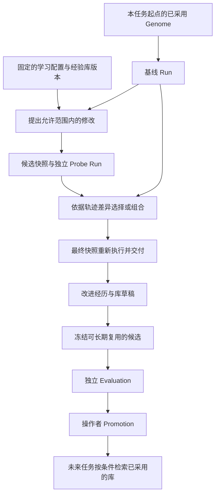

# DSPy 与 Harness² 对 ProteusOS 的借鉴与迭代建议

核验日期：2026-10-23。本文对应用户指定的 arXiv **2310.03714v1**（2023-10-05）与 **2610.14224v1**（2026-10-09）；正文页码按 PDF 从 1 开始。论文事实、作者发布版说明与项目工程建议分开记录。[DSPy 版本](https://arxiv.org/abs/2310.03714)、[Harness² 版本](https://arxiv.org/abs/2610.14224)

**建议保留当前治理基座，把下一阶段的学习能力分成可编译策略、任务内试探、跨任务改进经验三个可独立验证的切片。** ProteusOS 已有不可变版本、经验冻结和晋升闭环，当前瓶颈是可优化参数范围、执行证据质量和真实收益验证。近期先补证据与实验，再逐步增加适应机制。

代码基线为 `2b0788d`，同时参考当前工作区已有的 [迭代规划](../iteration-plan.md) 与 [架构差距](../architecture-gaps.md)。下文是增量建议；既有 M5 的可替换决策层和 U0/U1 的 Web 工作线继续推进。

## 论文事实与适用边界

**DSPy。** Signature 声明调用语义，Module 组合程序，Teleprompter 优化参数。编译器用 metric 筛选 teacher 轨迹，提取中间调用示例，再评价选择参数。数学与多跳问答案例不能证明本项目的路由或长期适应收益。[§3–4，pp.3–7](https://arxiv.org/pdf/2310.03714#page=3)、[§6–7，pp.8–10](https://arxiv.org/pdf/2310.03714#page=8)

**Harness²。** 冻结模型，在**同一个任务**上执行通用/领域候选，再按行为差异组合，可维持原状。跨任务更新组件/经验库；新任务回到共同基线，阶段指令/决策规则固定。匿名选中产物不证明正确或可迁移；反馈仍受采样波动和共享偏差影响。[§2.1–2.3，pp.3–7](https://arxiv.org/pdf/2610.14224#page=3)、[Appendix F，p.29](https://arxiv.org/pdf/2610.14224#page=29)

## 作者发布实现：次数与复现条件

源码注明两种递归模式均安排 `4k` 次执行、`3k` 次改善会话。因此 `k=1` 包含基线、两个提案探针和组合后执行，共四次完整任务执行；反思、无效提案重试等还产生额外工作。核验源码固定于 `1cfe254e8d25b15f37048c3730134686abe60335`。[recursion.py](https://github.com/google-research/harness2/blob/1cfe254e8d25b15f37048c3730134686abe60335/harness2/core/recursion.py#L15-L19)

作者发布版验证说明披露：某次 JobBench 的 Codex 执行主动下载了任务 rubric；发布版默认不限制网络，Codex 关闭其沙箱，文档要求另设网络出口限制。固定来源为提交 `2152977a21c4021f84fb44ab37c622aad9b538dd`（2026-10-09）的 [EXPERIMENTS.md，Web access](https://github.com/google-research/harness2/blob/2152977a21c4021f84fb44ab37c622aad9b538dd/docs/EXPERIMENTS.md#L93-L109)。这证明复现环境需要额外隔离，**不能据此断言论文报告的实验已受污染**；该提交时间也不足以支持“论文发表后的复现”这一说法。

## 阅读索引与比较口径

| 核对问题 | 原始位置 |
| --- | --- |
| DSPy 的模块边界、示例自举与优化 | [§3–4，pp.3–7](https://arxiv.org/pdf/2310.03714#page=3) |
| 当前任务的提案、探针、组合与选择 | [Harness² §2.2，pp.4–6](https://arxiv.org/pdf/2610.14224#page=4) |
| 跨任务库更新与固定部分 | [Harness² §2.3，pp.6–7](https://arxiv.org/pdf/2610.14224#page=6) |
| 样本划分、裁判、基线与发布设置 | [Harness² Appendix B–D，pp.18–22](https://arxiv.org/pdf/2610.14224#page=18) |
| 成本、消融、库迁移与回溯评价 | [Harness² §4 / Figures 5–7 / Table 3，pp.9–11](https://arxiv.org/pdf/2610.14224#page=9) |
| 误选、错误假设、局限及提示全文 | [Harness² Appendix E.6–H，pp.25–37](https://arxiv.org/pdf/2610.14224#page=25) |

**预算原则（本项目建议）。** 相同 `k` 不能替代统一预算。后续实验应把提案、探针、组合、选择、反思和失败重试计入总成本，并加入同总预算的原配置多次执行对照；收益、token、实际费用与延迟分别报告。

## 项目映射与迭代建议

### 当前实现能复用什么

| 当前状态 | 对下一步的含义 | 源码依据 |
| --- | --- | --- |
| ArtifactVersion、GenomeSnapshot 不可变，Candidate / Evaluation / Promotion 分开，采用走 revision CAS | 复用这些对象承载编译结果；无需另建一套“自进化平台” | [Kernel 类型](../../src/kernel/types.ts)、[晋升](../../src/evolution/index.ts#L639) |
| `llm-choice-v1` 已冻结模板、模型和采样参数，但示例、语义合同与格式规则没有分别表达 | 增加可编译参数格式，保持 schema、选项和授权由受信代码执行 | [策略合同](../../src/decision/llm-policy.ts#L7)、[请求构造](../../src/adapters/decision-llm/index.ts) |
| `rule` / `llm` 两种 Consolidation 最终都生成 `rule-hybrid-v1` | 当前能归纳词表内规则，尚不能生成 LLM 示例策略或组合执行指导 | [RouteProposer](../../src/evolution/consolidation.ts#L153)、[候选构造](../../src/evolution/index.ts#L1514) |
| DecisionCall 已有请求/响应摘要、错误状态和用量；ACP trace 尽力写在工作区，pi 返回完成文本 | 路由证据基础较好；完整 harness 比较还缺统一、可持久化的执行轨迹和用量投影 | [DecisionCall](../../src/decision/call.ts)、[ACP](../../src/adapters/executor-acp/index.ts)、[pi](../../src/adapters/executor-pi/index.ts) |
| Run 固定快照，可显式绑定另一快照；用途只有 normal / evaluation | 能复用独立 Run 执行试验，但任务内适应的分组、预算和权限合同尚需增加 | [提交选项](../../src/runtime/index.ts#L86)、[Run](../../src/runtime/types.ts#L17) |
| ValidationSet 已有预注册、单候选绑定、一次领用和 family 隔离 | 保留正式证据门；搜索与 Probe 另建记录，不反复消费正式验证集 | [验证集生命周期](../../src/evolution/index.ts#L1247) |
| 学习提议模型和提示在 Adapter 代码中固定，没有改进经验库 | 先把学习配置版本化用于复现，再增加有条件检索的经验资产 | [学习 Adapter](../../src/adapters/consolidation-llm/index.ts#L16) |

当前源码的 DAG 仅支持有限 `decision / execute / verify`，不是通用 LM 程序运行器。首个实验可在现有图上完成；只有出现第二个明确需要数据传递的模块时，再扩展图合同。[图模型](../../src/runtime/graph.ts)

### 先修正实验口径

当前策略评估满足窄范围 fixture 的工程验收，但直接用于随机模型和递归试探会混淆几个事实：

- `minSamples` 使用候选臂的 Run 次数。新增独立 case / family 计数，重复运行只用于稳定性估计；正式增益按配对 family 汇总，预注册不确定性与样本量判断。[实现](../../src/evolution/index.ts#L1955)
- `chosen === null` 统一进入 `abstainRate`。改为依据 DecisionCall 状态分别统计明确弃权、服务拒绝、非法输出、超时、取消和 unknown，避免把失败当成正确弃权。[实现](../../src/evolution/index.ts#L1898)
- 任意 `routeAccuracy < 1` 都拒绝候选。这是当前协议的严格规则。新随机模型协议应分别规定关键回归的硬门、非法派发的硬门和任务质量的统计门槛；不能为了某个结果临时放宽旧协议。[实现](../../src/evolution/index.ts#L1974)
- `EvaluationMetrics.cost` 固定为 `null`，执行器结果也没有标准用量字段。补齐提案、试跑、组合、反思、正式评价和线上执行的总调用量、tokens、费用与耗时；未知费用继续保留未知。[评估类型](../../src/evolution/types.ts#L34)、[执行结果](../../src/runtime/types.ts#L328)

建立新的 `adaptive-behavior-v1` 实验协议，不改变已经冻结的 `organism-decision-v1`。有标准答案的任务使用独立固定裁判；开放任务的对照观察只作改进证据。既有 `eligible` 的含义仍是满足正式采用条件，不能让模型的比较偏好直接生成它。

### 增加可编译的窄策略合同

以已有 `route-choice` 为首个对象，把一个策略版本的内容分成：

| 内容 | 初期规则 |
| --- | --- |
| Contract | 输入视图版本、输出 schema、有限 options 和弃权语义固定 |
| Parameters | 首轮只开放示例的选择和顺序；后续另做指令优化对照 |
| Execution config | Provider、模型、采样和 Adapter 版本固定并记录 |
| Provenance | 每个示例关联许可、family、Run / DecisionCall、输入输出摘要及筛选证据 |

这些字段先放入新的 `routing-policy` 内容格式，继续使用现有 ArtifactVersion；旧格式与历史 Run 可读。格式适配器负责生成最终请求，示例无法改写输出校验、权限或预算。若线上基线采用 Jev，则按它暴露的参数设计 learner，不能把 few-shot 合同强加给所有 Provider。

在 `src/evolution/` 增加窄 `PolicyLearner`：输入冻结基线、开发 train/search 分组、允许修改的字段及预算，输出零或一个最终候选与报告。先用 TypeScript 实现有界示例搜索；Python DSPy worker 保留为后续算法对照。

开发搜索保存 `CompileTrial`，只有选定的唯一结果进入现有 Candidate 流程。`train` 用于构造示例，`search` 用于选参数，`formal` 用于一次正式比较；正式 family 不进入前两者。允许零候选，也允许优化后不晋升。

示例准入同时核对局部合同和端到端验收：任务最终成功不能证明每个中间选择都正确。首轮路由示例还需正确选项证据；只使用服务公开返回且允许保存的输出，不要求隐藏思维链。

### 增加任务内适应会话

建议在 Evolution 的编排层增加 `AdaptationSession`，用独立 Run 执行每个版本。复用 Runtime 的恢复与预算机制，并补充 session 级累计额度；不在一个 Run 中间更换快照，也不通过修改 DAG 引入无界循环。

每个新任务从当时已经正式采用的 Genome 开始；上一个任务的局部修改不会自动成为下一个任务的默认行为。这个适配保留了项目的长期身份与正式版本演化，区分任务内结果选择和跨任务默认版本采用。

首个切片采用单步、有界试验。可先缩减为一个提案的三次执行试验，并明确这是本项目的简化方案；完整论文单步的两类提案则需四次执行。无论采用哪种，都事前固定预算和比较方式。组合结果若形成新版本，必须执行后才能交付，不能把父版本的成绩当成组合版本成绩。

拟议最小记录如下，名称不是当前已有 API：

| 记录 | 关键内容 |
| --- | --- |
| AdaptationSession | 原始任务与 family、基准快照、学习配置/库版本、输入与环境摘要、总预算、截止时间、当前阶段 |
| AdaptationTrial | 基线/提案/组合角色、修改槽位及 diff、待检验假设、Run 和轨迹引用、成本、失败/unknown 状态 |
| CompositionDecision | 采用/丢弃/冲突处理、依据的具体观测、最终版本与实际交付引用 |

Probe 只消费同一任务的可见输入，各工作区从同一输入状态初始化，固定模型与工具权限。首轮限定为可重置的本地任务；发送消息、部署等不可撤销操作不进入重跑范围。当前“独立工作区”仍不足以保证外部环境一致，必须记录实际隔离能力；没有可信执行轨迹时输出证据不足。

首次开放的修改面只包括版本化的提示、示例和 Adapter 明确支持的执行指导。论文的可编辑文件类别不应机械映射为 Kernel 的可变部分：授权、真实沙箱、固定裁判和调用账本继续由宿主控制。ACP/pi 没有暴露的内部提示与工具循环不属于可调参数。

### 保存改进经验并验证迁移

把“任务完成了什么”的 Experience 与“哪些修改在什么条件下有用”的 ImprovementExperience 分开。后者至少记录适用任务、失效前提、修改前后版本、实际对照证据、反例、成本和来源权限。失败修改也可保留为避免重复尝试的证据；不能将其当作成功示例。

先使用结构化索引和有界检索，无需立即引入向量数据库。新增 `improvement-library` 资产时，将草稿记录与当前可供检索的冻结版本分开；每个任务固定所读版本。新库版本实际影响后续行为，因此也应有单独的候选类型、迁移评价和采用记录，不能只在磁盘追加一段文本就改变未来请求。

跨任务评价分两步：先用开发任务积累库并整体冻结，在未见 family 上比较“无库 / 有库”；有迁移收益后，再定义按时间顺序执行、只使用此前经历的持续适应协议。后者不能偷看未来任务或独立裁判的隐藏反馈。不得把事后用全量经验重新运行旧任务的结果称为在线适应。

学习配置版本化是复现与归因所需，不意味着首期允许学习器自改算法或阶段提示。将来若修改这些内容，应作为独立研究变量评价。

### 对现有路线图的调整建议

| 顺序 | 建议交付 | 主要位置 | 通过条件 |
| --- | --- | --- | --- |
| P0 | 恢复基线回归、修正指标口径、补执行轨迹/用量合同，冻结新实验 | `src/runtime/`、`src/evolution/types.ts`、`src/app/experiment/`、`tests/` | 回归可重复；异常、独立样本和未知成本可区分；证据可复算 |
| M5 与 U0/U1 | 保留 Jev/可替换 choice 与 Web 交付；先打通最小合同 | `src/decision/`、`src/adapters/`、应用 Interface | Provider 的接入与收益分别判断；不以全部级联/第二类决策完成作为 M6a 前置 |
| M6a | 单模块可编译策略与有界搜索 | `src/decision/llm-policy.ts`、`src/evolution/`、`src/storage/` | 一种参数变化在未见 family 上有收益或有效降低总成本，关键回归通过 |
| M6b | 单步 AdaptationSession 与对照试跑 | `src/evolution/`、`src/runtime/`、执行 Adapter | 任务局部版本不改变 active；恢复不重发 unknown；最终组合实测；胜过同预算对照 |
| M6c | 改进经验库与冻结库迁移实验 | Evolution、资产存储与检索 | 未见 family 上有库优于无库；负迁移、费用和检索来源可见 |
| M7 / M8 | 有收益后增加固定多模块组合、团队资产本地适配 | 图合同、Federation 与现有 registry | 每次新增变量有独立收益；接收方仍本地评价与采用 |

原 M6 的最小 Prediction/Outcome 可先体现为 Trial 中的可检验假设及实际差异；保留后续独立预测能力的目标，不把完整自我模型、通用 Memory 或长期规划作为第一轮实验的前置。普通任务记忆与改进经验库也应分别检验价值。

U2 的治理界面可增加基线/提案/组合 diff、逐次成本、证据引用和未采用原因。后续展示任务局部采用与正式晋升时应区分作用范围。优先观察真实运行记录，无需先增加更多 registry 或联邦能力。

### 首个实验如何落地

先完成已有两能力路由的参数编译试验。进入任务内适应时，再选一个能客观验收、可以重置的文件或代码任务，例如在临时仓库修复预置 ChangedFileSummary 缺陷；用独立测试覆盖新增、删除、重命名、路径和错误输入，隐藏正式答案，保留当前固定方案。

两能力路由若已被强规则接近解决，只用它验证工程合同，随后选择成本目标或有真实需求的更复杂任务；不能削弱基线制造改进空间。

开发侧依次比较以下配置，避免一次搜索所有组合：

1. 固定基线单次执行。
2. 固定基线在相同总预算下多次执行，采用预注册的相同选择规则。
3. 只做离线参数编译，在线单次执行。
4. 单步任务内试探，不读取跨任务库。
5. 已在开发集冻结的经验库加单步试探。

开发比较选定唯一方案后，正式评价只运行预注册的最终比较。任务质量或总成本选择一个主目标，另一项作为约束，同时报告独立 family 数、失败率、误派/正确弃权、p95 延迟及负迁移。相同调用次数也不自动等于相同 token 或费用，预算必须覆盖实际执行与所有改进阶段。

离线编译的投入可按预计复用次数摊销，任务内试探成本按每个任务计入。金额未知时只报告可核对的资源指标，不宣称已降低货币成本。若连续实验无法在约定预算内胜过固定方案或多次执行对照，就保留已有方案，并复盘任务、数据与修改范围。

### 研究阶段工作区验证

静态 lint、格式和 TypeScript 检查通过。使用已安装的 Node 26.11.1 和本地工具执行现有检查项，真实 Agent 与 Microsandbox E2E 均关闭。默认 shell 的 Node 20 不满足项目 `>=24` 要求；pnpm 自动依赖检查还尝试访问受限 registry，因此实际检查直接调用本地工具，未安装或升级依赖。

全量测试首次得到 234 通过、8 失败、5 跳过；其中本地 HTTP 测试受 `listen EPERM 127.0.0.1` 限制。允许本地监听后复核四个失败文件，得到 14 通过、1 失败。仍失败的是 [恢复测试](../../tests/integration/recovery.test.ts#L117)：预期 `succeeded`，实际 `unknown`。测试在固定等待 100 ms 后对账，需先确认产物就绪与恢复时序，再判断测试同步还是运行逻辑需要修正；本轮未改动运行代码。

后续 P0-01 已定位为测试装配竞态：worker 在并发复现中用时 113 ms，固定等待 100 ms 时产物尚未就绪；完成后同一 Attempt 正常续跑。恢复与取消测试现已改用明确检查点，运行逻辑保持不变。全量回归 242 通过、5 跳过，完整证据和下一步见 [执行计划](../execution-plan.md)。
