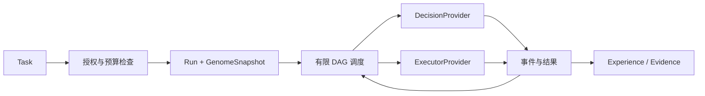

# 运行时、决策与执行合同

状态：设计基线。M0/M1 已实现并通过验收测试与真实 agent E2E 验证（2026-09-20），实现位于 `src/`，与本文的差异及落地选择见文末[实现注记](#9-实现注记m0m1)。
术语以 [领域词汇](CONTEXT.md) 为准，记录关系见 [领域模型](domain-model.md)，模块边界见 [总体架构](architecture.md)。

## 1. 执行单位与版本绑定

| 对象 | 职责 | 生命周期 |
| --- | --- | --- |
| Task | 描述用户目标、输入、验收条件与授权范围 | 可以有多个 Run |
| Run | 对 Task 的一次完整执行，持有固定执行图与预算 | 从创建到成功、失败或取消 |
| Process | Run 内的执行单元或 worker，承载节点工作 | 不等同于独立 Organism 或操作系统进程 |
| Attempt | Process 的一次执行尝试 | 每次重试产生新 ID |
| Provider session | 外部适配器的会话上下文 | 可供同一 Process 内顺序交互，不决定 Run 身份 |

MVP 为执行节点建立 Process，重试沿用 Process 身份并创建新 Attempt。
一个 Organism 可以并发运行多个 Task/Run，各 Run 的经验归属于同一个 Organism。
跨 Organism 合作须显式传递授权与产物，不能借 session 或工作目录隐式共享内部状态。

普通 Run 创建时，原子读取 Organism 的 `activeGenome` 指针及 revision，并持久化解析后的 `GenomeSnapshot` 引用。
Snapshot 包含完整依赖闭包内的精确 ArtifactVersion 引用；运行期间禁止解析 `latest`。
ArtifactVersion 不可变；“当前启用”是 Organism 与 Snapshot 的关系，不是版本对象上的可变状态。
代码、图、决策策略、提示词、模型配置及 evaluator 均按实际使用情况记录版本来源。
托管模型无法固定底层权重时，记录服务标识与所报告版本，并标注该复现限制。

评估 Run 是显式授权的特殊用途：可绑定已注册但未激活的 Candidate Snapshot，或绑定基线 Snapshot 做对照。
记录 `purpose=evaluation`、Candidate、评估计划引用及独立权限/预算；该入口不改变 activeGenome。
受测行为与裁判分开：候选控制受测工作，独立评估计划固定输入、裁判与验收规则，候选不能替换本轮裁判。

进化晋升只改变之后创建 Run 所读取的指针；恢复既有 Run 必须继续原 Snapshot。
Generation barrier 是经验冻结与版本切换边界，不要求暂停所有正在执行的 Run。
Run 内允许调整 L3 临时阈值等状态，但须记录初值、变更事件及适用范围。
这些变化若要影响下次 Run，必须形成 Candidate 并经过 [进化流程](evolution.md)。

## 2. 内核与运行时的分工

Kernel 定义身份、版本、事件、能力约束，以及晋升与回滚的合法性。
Runtime 负责图验证、调度、状态迁移、预算分配、执行派发与故障恢复。
Provider 负责具体推理或执行；不能自行改写 Snapshot、提升权限或晋升产物。
Kernel 不包含 planner、模型路由策略、ACP session 语义或图调度算法。



MVP 图是提交前可验证的有限 DAG：节点 ID 唯一、依赖存在、无环、输入输出 schema 匹配。
节点包含输入引用、所需能力、超时、重试上限、输出 schema 与完成判据。
先实现 `decision`、`execute`、`verify`；人工等待用显式等待状态表示。
复杂 planner、动态扩图、递归子图与长期自治循环延后，不藏在无限重试中。
外部 worker 可以在自身 session 中多轮工作，但必须受 Run 的时间、费用与权限边界约束。

前置节点成功且输入完整，节点才能进入 ready；未选中的分支标记 skipped 并记录原因。
下游 join 必须声明依赖分支规则，不能把 skipped 隐式解释为成功或失败。
Run 成功要求必需节点及验收节点均通过，外部 agent 表示“完成”不构成验收。
共享资源通过并发配额与资源锁协调；单个 Run 的预算不能侵占 Organism 的保留资源。
派发事务同时预留 Organism/Run/Attempt 的额度；结算后释放差额，unknown 调用保留未结算预留并对账。
撤权和预算检查使用当前账本，行为快照不会冻结授权。无法限制最大费用的 provider 不得宣称精确费用封顶；
任务要求硬上限而 provider/宿主无法施加时，拒绝准入或改用满足约束的执行方式。

## 3. DecisionProvider：只回答类型化问题

以下为行为合同示意，具体 TypeScript 类型在实现时细化：

```ts
interface DecisionProvider {
  capabilities(): DecisionCapabilities
  decide(request: DecisionRequest): Promise<DecisionResult>
}
type DecisionResult =
  | { kind: 'value'; value: unknown; provenance: Provenance;
      confidence?: number; calibrationRef?: ArtifactVersionRef }
  | { kind: 'abstain'; reason: string; provenance: Provenance }
```

Request 包含 problem/schema、状态快照引用、选项、policy 版本、deadline 和剩余预算。
Capabilities 声明支持的问题类型、输入限制、成本报告与取消能力；不支持时返回明确错误。

| 首批问题类型 | 成功结果约束 |
| --- | --- |
| choice | 返回给定选项中的一个稳定 ID |
| rank | 返回无重复选项 ID；请求明确是全排列还是有限 top-k |
| gate | 返回 allow/deny 及可记录的原因；abstain 独立于 allow |

Runtime 必须独立验证结果 schema、选项成员关系与数量限制。
非法输出归类为 `invalid_output`，不能通过截断文本、猜测 ID 或默认 allow 来修复。
`abstain` 表示提供者无法可靠作答，与网络错误、预算耗尽、非法输出分开记录。
Gate 的 allow 只表示策略建议，最终仍受 Kernel 能力授权约束。

confidence 可以缺省；模型自报值、规则确定性和校准概率并不是同一种量。
跨 provider 的 confidence 不直接排序；只有明确校准数据与适用任务域才可用于阈值策略。
RuleProvider、分类器、reranker、小模型或大型模型均通过同一合同接入；不绑定某一厂商。
级联顺序由版本化 Policy 决定，每次升级前检查剩余调用数、时间与费用预算。
预算耗尽或全部 abstain 时进入人工等待或失败，选择由图的明确策略决定。

所有推理记录问题 schema、输入引用、所用版本、选项、结果、延迟和已知成本。
缺失成本必须标记 unknown，不能按零费用计入策略比较。
DecisionProvider 不持有执行副作用的能力，也不原地修改用于后续 Run 的模型或规则。

## 4. PolicyLearner：离线产生候选

```ts
interface PolicyLearner {
  learn(dataset: ExperienceDatasetRef,
        base: ArtifactVersionRef): Promise<CandidateRef>
}
```

训练、蒸馏、规则归纳与模型微调属于离线学习职责，不加入 DecisionProvider 的在线接口。
Learner 读取冻结的数据集和基础版本，输出新的不可变版本及 Candidate，不覆盖基础版本。
训练本身消耗独立预算并留下 Run 记录；其输出必须通过 Evaluation、Promotion 后才能启用。
M0 不实现学习器；规则决策加本地进程即可验证完整运行记录与恢复能力。

## 5. ExecutorProvider：受约束地执行副作用

```ts
interface ExecutorProvider {
  capabilities(): Promise<ExecutorCapabilities>
  start(request: ExecutionRequest): Promise<ExecutionHandle>
  events(handle: ExecutionHandle): AsyncIterable<ExecutorEvent>
  cancel(handle: ExecutionHandle): Promise<CancelReceipt>
  inspect?(handle: ExecutionHandle): Promise<ExecutionObservation>
}
```

ExecutionRequest 绑定 Run/Process/Attempt、输入与版本引用、权限、工作区、预算和派发 ID。
Handle 是 provider 的执行句柄，不叫 RunHandle；远端 session ID 不能替代内部 Run ID。
Capabilities 明确声明可否恢复、查询、取消、去重，以及实际可施加的隔离限制。
可选能力不存在时，Runtime 采用保守行为，不伪造恢复或幂等保证。
`start` 成功只表示获得执行句柄；`cancel` 返回只表示取消请求已接收。
只有可验证的结束报告才能确定执行终态；断连或 deadline 到期不证明副作用停止。

输出分为日志、进度、权限请求、产物与结束报告，全部关联当前 Attempt。
产物须完成 schema、大小、路径与内容摘要检查，再注册为不可变 ArtifactVersion。
外部 provider 的原始消息可保留受控引用；核心领域事件只接收规范化字段。
stdout 中的自然语言指令不能改变权限、预算、晋升规则或调度状态。

每个写入型 Process 使用独立工作区；并发 worker 不直接修改同一份 checkout。
工作区路径或 Git worktree 只隔离文件变更，不构成安全 sandbox。
文件访问、网络、凭据与进程树限制必须由可信宿主或真实隔离环境施加。
M0 本地进程仅运行 operator 信任的代码；执行外部生成代码前必须具备受控执行环境。
若无法落实所要求的限制，拒绝派发该工作，不把“权限声明”当成已生效的约束。

## 6. ACP 适配器边界

本节按 ACP 官方 v1 文档描述，核验日期：2026-09-20。实现时锁定 SDK 与实际协商的协议版本。
ACP 提供 client 与 agent 的会话交互，ProteusOS 的 Task、Run、Snapshot 与晋升语义保留在内部。

| ACP 能力 | ProteusOS 适配行为 |
| --- | --- |
| initialize | 协商版本与能力，并记录 agent/adapter 配置 |
| session/new | 在受控工作区创建 Process 所需的 session |
| session/prompt、session/update | 提交一次交互并转换输出与工具活动 |
| session/cancel | 请求终止当前交互，继续接收尾部更新 |
| session/request_permission | 根据既有授权判断，或进入用户等待；保存请求与决定 |

初始化必须先于会话建立，未声明的可选能力不能使用；会话加载依赖 `loadSession` 能力。
参见 [Initialization](https://agentclientprotocol.com/protocol/v1/initialization) 与 [Session Setup](https://agentclientprotocol.com/protocol/v1/session-setup)。

v1 的 prompt 返回 stop reason；`end_turn` 只表示本轮结束，不能直接映射为任务成功。
发送 cancel 后仍接收尾部更新，等待原 prompt 的 cancelled 结果；待处理权限请求回应 cancelled。
参见 [Prompt Turn](https://agentclientprotocol.com/protocol/v1/prompt-turn#cancellation)。

Permission request 是授权交互，不是 sandbox；agent 自身及其工具仍必须受真实执行边界约束。
协议允许客户端按用户配置作出权限决定，但配置不能扩大 Task 已授予的权限。
参见 [Tool Calls](https://agentclientprotocol.com/protocol/v1/tool-calls#requesting-permission)。

M1 已选择并落地两个 ACP worker 与一条 SDK 直连路径（[ADR 0005](./adr/0005-external-executors.md)）：Claude Code 经 `@agentclientprotocol/claude-agent-acp`、Codex 经 `@agentclientprotocol/codex-acp`，client 端统一基于官方 `@agentclientprotocol/sdk`；pi 无原生 ACP，经其官方 SDK `@earendil-works/pi-coding-agent` 直连。能力协商、权限请求、产物验收与断连/取消合同已由验收测试覆盖（CI 用真实协议的 fake agent；真实凭据 E2E 显式启用，Claude Code 与 Codex 已通过）。受控执行环境（真隔离）仍是独立待决策项（见[路线图待验证项](./roadmap.md#待验证项)）。
未来采用其他协议只增加 adapter，不改变内部领域对象。

## 7. 持久化、派发与事件合同

建议默认采用本地 SQLite 单 writer，加按摘要寻址的 blob 存储；这只是 M0 方案，尚无实现。
同一数据库事务提交运行状态迁移、事件与待派发 outbox 记录；外部调用放在事务提交之后。
Outbox dispatcher 认领记录后调用 provider，再保存 handle、回执与规范化结果事件。
外部执行与数据库提交没有共享事务，因此系统不承诺副作用 exactly-once。

| 字段 | 约束 |
| --- | --- |
| eventId | 全局唯一事件标识；摄取时去重 |
| streamId、seq | 每个聚合事件流内递增序号；唯一约束阻止并发覆盖 |
| type、schemaVersion | 明确 payload 合同版本；未知版本不得静默解释 |
| correlationId | 串联一次任务执行及相关操作，通常绑定 Run |
| causationId | 指向触发当前事件的命令或事件 |
| organismId、runId、processId、attemptId | 按事件适用范围提供身份归属 |
| occurredAt、recordedAt | 外部发生时间与本地记录时间；不能代替 seq 排序 |
| dispatchId、idempotencyKey | 区分命令身份与 provider 实际支持的副作用去重键 |

相同派发重送沿用 dispatchId；新 Attempt 使用新身份，并显式决定业务幂等键是否保持。
不支持幂等键的 provider 不能因 outbox 重投而盲目再次执行未知状态命令。
原始 provider 事件无稳定 ID 时，不凭文本相同断定重复；记录适配器摄取序号与连接 epoch。
必要的脱敏在持久化前完成；秘密值不进入事件、提示词快照或经验导出。

Blob 先写临时对象，完成内容校验及原子落位后，事务才登记引用。
事务失败可能留下未引用 blob，可延迟回收；已引用内容缺失时停止相关 Run 并报告损坏。
Checkpoint 保存状态投影、Snapshot 引用和已应用 seq；不能替代历史事件与结果证据。

## 8. 终态、超时与恢复

Run 使用 `pending / running / waiting / succeeded / failed / cancelled` 表达调度状态。
Attempt 另有 `dispatching / running / cancel_requested / unknown / succeeded / failed / cancelled`。
未知 Attempt 使 Run 进入 waiting；只有完成对账或明确人工处置后才能继续。
超时是触发事件与失败原因，不能直接把外部 Attempt 标记为 cancelled。

收到用户取消或撤权后，先持久化停止意图，阻止 ready/outbox 新派发与自动重试，结束待处理权限等待，
再向所有活动 Attempt 请求取消。已跨过派发边界的请求仍需对账；未确认停止的 Attempt 保持 unknown，Run 保持 waiting。
确认活动执行结束后，按实际结果结案；已经完成的结果不因迟到的取消请求被改写为 cancelled。

| 情况 | 必须采取的恢复行为 |
| --- | --- |
| 派发前崩溃 | 恢复已提交 outbox；检查预算、授权和认领状态 |
| 调用可能已到达，但未保存 handle | 标记 unknown；优先按派发 ID 查询，无法查询则等待对账 |
| 执行中断连 | 查询或重新连接原执行；不得创建“替代”副作用 |
| 明确失败且可安全重试 | 新建 Attempt；按有界退避和剩余预算重试 |
| deadline 到期 | 记录超时并请求取消；截止等待时间后仍未知则进入对账 |
| 收到迟到结果 | 关联原 Attempt，记录证据；不得自动覆盖已确认终态 |

失败是否可重试必须结合副作用清单：仅凭错误码为 transient 不足以重试。
补偿操作也是新的授权执行，取消不会撤销已经发生的文件写入、提交或远端调用。
必要时可将 Run 人工结案为失败，但必须保留未解决副作用记录并阻止冲突工作继续。
进程树已退出或协议取消已确认，只证明执行终止，不证明此前副作用已回滚。

状态回放仅应用已记录事件重建投影，不调用 provider，不重做外部副作用。
反事实评估使用保存的输入与结果、纯函数或受控模拟；真实重跑创建新 Run 并重新授权预算。
记录执行来源能支持后续归因，但单次成功日志不证明某个策略或模型具有因果贡献。

M0 验收覆盖断点恢复、重复事件、未知执行、取消竞态、预算耗尽及 Snapshot 固定。
M1 增加真实 ACP 的能力协商、权限请求、产物验收、断连与取消测试。
实现顺序见 [路线图](roadmap.md)，代码边界见 [仓库设计](repository.md)，入口见 [文档索引](README.md)。

## 9. 实现注记（M0–M2）

实现（`src/`）与本文设计基线的对应关系及已落地的具体选择：

| 主题 | 实现选择 |
| --- | --- |
| 执行器装配 | 注册表：图中 executor 名 → 实现（`local-process` / `claude-code-acp` / `codex-acp` / `pi`）；未装配名得到明确 `unknown_executor`，不做隐式回退 |
| 任务指令 | `ExecutionRequest.prompt` 携带 Task.goal；本地 worker 可忽略，agent 型执行器以此为用户消息 |
| ACP client | 官方 `@agentclientprotocol/sdk`：initialize → session/new（cwd 钉在工作区）→ prompt → update 收集；`end_turn` 只表示本轮结束，成功与否由 verify 裁定 |
| 权限策略 | 可注入；默认选首个 allow 类选项（工作区一次性目录），无人值守可换 deny-all；全部请求与决定记入 trace |
| 超时取消 | 先发 `session/cancel` 通知并等待尾部更新，5s 宽限后仍无终态才 SIGKILL（断连只证明进程终止，不证明副作用停止） |
| trace | update 流与权限决定落盘工作区 `.proteus/acp-trace.json`（产出可定位 trace） |
| pi 直连 | 进程内 SDK（`createAgentSession`），非子进程隔离；对一次性工作区按操作者决定显式授信（`projectTrusted`） |
| 验收裁判 | 按快照 `acceptance-evaluator` 产物内容分发：`stats-acceptance-v1`（JSON Schema + totals 一致性）与 `test-runner-v1`（工作区内跑测试命令，退出码即判据） |
| 重试身份 | 重试沿用 Process、仅新建 Attempt（§1 的模型）；Attempt 配额检查与创建同事务 |
| 恢复命令 | `proteus recover`（遗留派发标记 unknown、Run 置 waiting；其余断点续跑，跳过已成功节点）与 `proteus reconcile`（完整工作区产物判成功；仅 `retry-safe` 执行器可在缺失产物时判失败并有界重试；ACP、pi 与动态能力执行器保持 unknown，等待人工或外部证据） |
| M0 未实现项 | §5 的 handle/事件流/cancel 完整执行器合同、多 Attempt 重试的自动触发（当前重试经对账或人工触发）、`inspect` 的恢复能力声明——按需在后续里程碑补齐 |

### 9.1 实现注记（M2）

| 主题 | 实现选择 |
| --- | --- |
| 能力声明 | Task `requires`（单段可移植 slug）↔ 快照槽位 `capability/<name>`；任务准入、候选构造与能力产物解析统一校验，缺口 Run 直接以 `waiting` 创建（`missing_capabilities` + `waiting_until`），不执行图 |
| 缺口等待出路 | 只有两条：被 `supersede` 接替（`failed/superseded`）或 `advance` 到期结案（`failed/missing_capability`）；Run 固定自身快照，不存在“能力补齐续跑”——`executeRun` 拒绝缺口 Run，`recover` 识别为 `waiting_capability` |
| 能力执行 | `capability/` 前缀执行器名 → 快照槽位产物（`capability-module-v1`）落盘工作区 → 独立 node 子进程（cwd=工作区、超时、名称与文件目标双重路径边界校验）；不热加载进 kernel（ADR 0006；进程级隔离，真隔离 M3） |
| 晋升事务 | 最新 Evaluation 的 `eligible` 门在与 CAS 晋升相同的 `BEGIN IMMEDIATE` 事务内读取；事务开始前捕获的旧结论不能用于晋升 |
| 能力路由 | 决策上下文把 task.requires 展开为 `capability:<name>: true` 布尔键；组合图 decision options 追加能力执行器名；rule-v1 严格匹配零扩展，无声明任务走兜底规则（回归语义） |
| 评估 Run 入口 | `submitTask(input, options)`：`purpose=evaluation` 显式绑定 `snapshotId`（不读不改 activeGenome）；`evaluatorVersionId` 仅评估用途允许并持久化于 `runs.evaluator_version_id`（恢复/续跑裁判不漂移）；`supersedesRunId`/`taskRevision` 支撑接替 |
| 接替 | `proteus supersede <runId>`：R1 `failed/superseded` 结案 + 同 Task 修订（revision+1）的 R2 绑当前 active；既有经验与外部结果不抹去 |
| 裁判 | 新增 `hybrid-acceptance-v1`（stats 形态输出走与 v1 等价校验——等价性由 tests/evals 证明；其余走纯 JSON Schema）；与 v1/test-runner 同按产物内容分发 |
| 预算 | 评估 Run 与普通 Run 共享 organism 预算池（purpose 标记区分）；独立预算池 M3 |
