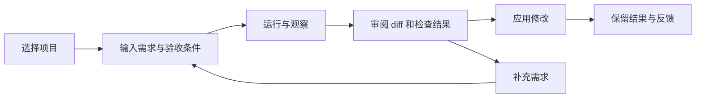

# ProteusOS Web 代码工作台实施计划

日期：2026-10-29。状态：代码任务工作台与首批规则学习/版本治理 UI 已接通；已完成内置浏览器核心流程验收及一次真实 Codex ACP 修复闭环。详细覆盖与未覆盖项见 [验收记录](./web-workbench-validation.md)。第一使用场景：选仓库、提需求、查看执行和产物，再审阅并应用代码改动。现有应用合同以 [交互设计](./interaction.md) 为基础，本计划补充 DSH 参考、日常代码任务所需能力和可逐步验收的交付顺序。

目标是让用户通过 `pnpm proteus web` 打开本地工作台，完成一次真实代码任务，全程无需手写 YAML、数据库 ID 或验收器配置。该命令尚未实现。首版面向本机单用户、一个默认长期个体；项目可以有多个，执行先串行。首版采用已有 ACP 执行器中的一个完成真实验收，其余执行器按实际验证情况开放。

## 产品主流程

1. **启动并连接**：首次打开时初始化或选择实例，检测执行器安装、登录状态和工作目录权限。缺失配置给出具体修复入口；耗费模型额度的连通测试由用户触发。
2. **添加项目**：选择仓库，展示分支、工作区变更、可用执行器和测试配置。首次接入确定哪些文件进入任务副本，以及允许执行的验证命令。
3. **描述任务**：输入“给这个接口增加分页并补充测试”等需求，选择任务类型，按需指定文件和验收条件。执行器、尝试次数和超时使用可见默认值。
4. **开始执行**：工作台展示需求卡、准备状态、执行过程、工具活动和等待原因；可请求停止。刷新或关闭页面不丢任务、不重复发送。
5. **审阅结果**：展示总结、文件 diff、测试结果和未完成项，点击文件可在右栏定位。执行器报告完成、自动检查通过和用户认可分别展示。
6. **继续或应用**：补充需求会基于选定结果启动关联的新 Run；应用修改前检查项目基线是否变化，冲突则保留产物并提示处理。应用成功后记录回执，默认不提交或推送 Git。
7. **保留经验**：保留任务、版本、结果和用户反馈的关联。后续学习仅消费许可的数据，是否采用新的行为仍经过现有评估和晋升流程。

第一版的“继续”是可追溯的关联任务，不承诺复用外部 Agent 的原始会话或在运行中插入指令。工作台 Thread 只组织需求、反馈和 Runs；它不替代 Organism 身份，也不成为新的 Agent 执行循环。

## DSH 参考与取舍

参考本机 `deepseek-harness` 的提交 `5badb15009ae1756c3afe0ae0cef1faafc290ccc`（2026-10-03）。以下描述针对该源码快照；产品入口可见 [DSH 官方仓库](https://github.com/deepseek-ai/deepseek-harness)。

| DSH 的具体做法 | ProteusOS 的采用方式 |
| --- | --- |
| [启动 Web 后配置模型、选择工作区、发送任务](https://github.com/deepseek-ai/deepseek-harness/blob/5badb15009ae1756c3afe0ae0cef1faafc290ccc/docs/user/guide/index.zh.md) | 同样以项目和任务输入为入口；配置页区分执行器认证与决策 Provider，首版不强迫用户配置 Jev 或学习模型 |
| [左栏、主区域、右侧内容栏](https://github.com/deepseek-ai/deepseek-harness/blob/5badb15009ae1756c3afe0ae0cef1faafc290ccc/packages/client/ui-layout/README.md) | 左栏项目与任务，中央需求和执行时间线，右栏文件、diff、测试与证据；窄窗口将右栏变为抽屉 |
| [对话记录中的过程折叠和文件引用](https://github.com/deepseek-ai/deepseek-harness/blob/5badb15009ae1756c3afe0ae0cef1faafc290ccc/packages/client/ui-chat/README.zh.md) | 默认突出结果、当前步骤和需要处理的事项；底层事件、DAG 和决策证据按需展开 |
| [独立产物入口](https://github.com/deepseek-ai/deepseek-harness/blob/5badb15009ae1756c3afe0ae0cef1faafc290ccc/packages/client/ui-deliverables/README.md) | 每个 Run 有可下载的报告、补丁和测试记录；不要求从日志里找文件路径 |
| [Host 权威状态与 Client 投影分离](https://github.com/deepseek-ai/deepseek-harness/blob/5badb15009ae1756c3afe0ae0cef1faafc290ccc/docs/subsystems/web-client.md) | 应用 Interface 负责用例和权威状态，浏览器负责展示、输入和可恢复订阅 |

实现采用 ProteusOS 自己的 React 页面与应用 Interface。DSH 的 Cordis 插件装配、动态客户端模块、Slots 和 Remote 系统有其完整依赖，首版不整套移植。需要复用具体代码时单独核对依赖和许可证，保留必要声明。接入 DSH Executor 是后续独立选择，不是实现 Web 的前置条件。

## 页面结构

首页直接进入最近项目的工作台，空实例显示接入引导。默认个体显示为“我的助手”；Organism、Genome、Attempt 等领域名称放在详情中，用户操作使用项目、任务、执行、检查、版本等词语。

| 区域 | 默认内容 | 展开内容 |
| --- | --- | --- |
| 左栏 | 新任务、项目列表、最近任务、运行中和待处理标记 | 搜索、归档、项目设置；高级入口为助手与改进 |
| 中央 | 需求输入、执行摘要、当前步骤、结果总结 | 工具活动、历史 Runs、结构化错误与处理操作 |
| 右栏 | 变更文件与 diff、报告预览、测试结果 | 决策来源、快照、预算、完整证据和 DAG |
| 设置 | 执行器状态、项目配置、任务默认预算、实例状态 | 个体切换、权限与版本；分享和团队管理后续加入 |

首批任务模板为“理解代码”“审查现有变更”“修改代码并验证”。模板填充执行图、输出协议和验收方式，用户无需接触 YAML。自由文本用于描述任务，不在首版引入独立的 LLM 任务规划器；由现有外部执行器完成任务内规划。

## 当前代码与实际缺口

以下以 ProteusOS 提交 `86efced` 为基线。工程能力与 Web 功能分别核对，避免重复建设或把实验设施直接当作日常产品。

当前工作区另有正在开发的 `src/app/development-pilot.ts` 及相关测试，包含单文件代码修复、冻结检查、独立执行和补丁导出。U1 的模板与结果清单应优先核对并复用其最终实现；它仍是有界试点，项目管理、浏览器交互、多文件修改与应用补丁需要继续交付。本计划不将这些未提交改动计为已验收能力。

| 代码事实 | 本轮工作 |
| --- | --- |
| [Runtime](../src/runtime/index.ts) 已有 `admitTask(input, options, bind)` 与 `executeRun(runId)`；`submitTask` 仍内联等待 | 复用事务内 bind，新增应用操作回执、持久化调度记录和 Host 所有权；不重新拆分 Runtime |
| [CLI](../src/app/commands.ts) 打开实例、调用业务并打印结果；[实例](../src/app/instance.ts) 按 actor 和 organism 装配 | 提取任务用例；Host 拥有资源和执行生命周期，CLI/Web 复用用例 |
| [Seed](../src/app/seed.ts) 默认仍为统计任务、规则路由与统计验收器 | 增加真实代码任务模板和兼容的精确版本绑定；旧统计模板仍可回归，不能仅修改 UI 输入框 |
| [验收器](../src/runtime/acceptance.ts) 已有 JSON/混合检查和固定测试命令 | 复用适用合同，补充报告、补丁和文件清单；测试验证与人工评价分开，输出合法不等于代码正确 |
| Runtime 将输入复制到每个 Run 的执行目录；尚无项目登记、Git 基线与补丁应用用例 | 建立 Project 与 ExecutionWorkspace，冻结输入并生成 diff，处理未提交修改、结果回收和基线冲突 |
| [执行器 Interface](../src/runtime/types.ts) 的 `start` 等待完成；[轨迹](../src/runtime/execution-evidence.ts) 有界收集后返回 | 增加执行中的公开事件与取消能力；现有结束后证据保留，缺失或截断必须可见 |
| `Runtime.cancel` 记录停止意图并中止决策调用，执行中 Attempt 主要等到节点边界才处理 | 扩展执行器取消传递与迟到结果处理，界面区分“正在停止”和已停止 |
| [ACP Adapter](../src/adapters/executor-acp/index.ts) 已处理 permission 请求，但当前有自动选择允许项的默认策略 | Web 代码任务显式装配权限策略；需要人处理的请求进入持久化待办，不能直接沿用默认策略冒充交互审批 |
| `evaluateTestRunner` 使用同步子进程；事件 seq 按 stream 分配 | 验证命令改为有界异步执行，确保长驻 Host 能响应查询与停止；订阅使用作用域游标，不把 seq 当全局游标 |

## 实现设计

### 应用 Interface 与本地 Host

沿用 TypeScript、React、Rsbuild、现有 Node.js 与 SQLite。React 官方提供 [Vite 客户端构建路径](https://react.dev/learn/build-a-react-app-from-scratch)；本项目已有服务器和领域实现，采用这一方式，依赖版本在实施时锁定。普通 HTTP 承载操作和查询，SSE 承载状态增量；首版没有双向终端需求。

按 [现有目录设计](./interaction.md#6-首期技术选择与目录) 增加 `src/app/contracts`、`use-cases`、`host`、`http` 和 `web/src`。先完成下列有明确消费者的用例，不建立通用插件平台：

- Projects：登记项目、读取 Git/文件状态、登记验证配置、预检输入、应用某个 Run 的修改。
- Tasks：预览任务配置、提交、查询、停止、基于结果发起后续任务。
- Observation：读取执行快照、事件、文件和产物；按游标继续观察。
- Interactions：读取并回复执行器权限请求，绑定 Run、Attempt、请求 ID 与有效期。

Thread、Project、Run 的关系由 Application Module 管理，Run/Attempt 和版本治理继续由现有领域 Module 管理。浏览器 DTO 不导出 Storage 或 SDK 对象，不解析 CLI stdout。

Host 对实例取得独占执行所有权，所有 CLI 写入口都需遵守。已迁移的 CLI 操作通过 Host；尚未迁移的写命令在 Host 活跃时明确拒绝并解释原因，不能绕过锁直接开实例。离线 CLI 模式取得相同所有权后继续可用。

提交时将幂等键、内容摘要、Task/Run、任务关联和调度记录原子持久化，再返回 accepted。后台派发使用持久化状态恢复；未知外部调用需要对账，不自动再发。预算沿用 Run 的绝对截止点，排队不重置额度。事件提交后才通知浏览器，采用快照与游标重同步，通知可重复但不产生第二次执行。

本地 Host 提供同源静态资源，默认仅监听 loopback。启动凭据换取浏览器会话，检查 Host、Origin 和写请求来源；HTTP 身份绑定本地操作者，浏览器的 actor 字段不能授予权限。项目、产物和订阅都按目标个体授权；凭据仅由 Host 管理。远端部署不进入首版。

### 项目副本与代码结果

首版支持普通 Git 仓库，执行目录与用户原工作区分开。输入基线包含 HEAD、选定文件摘要和明确纳入的未提交改动；默认排除 `.git`、依赖目录、构建产物和凭据文件。符号链接按真实路径检查范围；子模块、LFS 或超大输入未获支持时预检明确阻止，不生成不完整副本后继续执行。

项目副本、产物清单和 diff 是新增的应用能力，不能把现有 `inputs/` 复制直接当成完整 Git 工作区。每个模板固定执行根目录、输入布局、输出位置和验证命令的运行目录，形成可以独立测试的 Workspace Interface。依赖安装使用项目登记的准备步骤，并显示其网络和执行要求，不隐式运行任意安装脚本。

代码任务绑定兼容的执行图、执行器和验收器版本，Run 固定快照。给现有个体启用代码能力时展示所需版本变化并使用已有授权采用流程，不静默覆盖 activeGenome。执行器选择只能在该任务可用的绑定中切换。

结果包含总结、变更文件、补丁、自动检查和未完成项。读取型任务使用结构化报告检查；修改型任务使用登记的测试命令、路径约束和补丁检查。没有可用测试的任务可交付 diff，但清楚显示“未验证”，不能显示测试通过。

“应用修改”是独立写操作：绑定 Run 和输入基线，先检查原工作区，覆盖文件前验证摘要；支持添加、修改和删除，遇到部分失败能够恢复并留下回执。应用操作同样幂等。第一次版本至少支持补丁下载，并以浏览器内应用普通文本改动作为代码任务完成门；二进制改动可展示文件元数据并下载，批量自动应用后置。

### 执行流与交互

先流式展示执行状态、公开消息、工具调用摘要、测试输出和结果，不展示或索取模型隐藏思考。事件有大小、数量和速率限制；断线后从持久记录补齐。旧执行器若仅返回结束后轨迹，显示“执行中，暂无实时明细”，不能生成伪造进度。

Executor Interface 增加取消信号和受控事件接收位置，Runtime 保持结果记账权。取消执行器、停止验证命令、Host 退出和超时走同一生命周期；收到取消请求不代表远端已停止或费用归零。已终止的 Run 不被迟到回调改回成功，迟到证据仍可保存。

权限请求使用已有 ACP 协议语义，在 Application Module 中持久化等待状态。回答只对原请求生效；任务结束、执行器断线或期限届满后不能继续授权。浏览器重连可以再次看到待办，但 Host 重启不假装恢复仍在内存中的回调。先支持一次性允许/拒绝与项目固定策略，长期权限记忆后置。该流程不要求增加任意 HumanNode。

## 分阶段交付与估算

按一名熟悉仓库的开发者串行投入估算，均为工作日，不包含外部执行器安装或认证等待。第一版按代码任务完成定义验收。**约 2–3 周出现可试用的读取与报告闭环；约 4–6 周交付修改、验证、审阅和应用的完整代码工作台。** 早期交互文档的 2–3 周估计仅覆盖基础 Web，本计划增加了通用代码任务、实时执行、权限请求与补丁回收。

| 交付 | 投入 | 内容 | 完成门 |
| --- | --- | --- | --- |
| U0a 应用用例与 Host | 3–4 天 | submit/list/detail/cancel Interface，持久回执和调度，独占所有权，同源会话，CLI 接入或写入互斥 | 重复提交和响应丢失只产生一个 Run；重启不重发未知外部工作；HTTP 与 CLI 共享规则 |
| U0b 执行观察与停止 | 3–5 天 | 授权事件投影、SSE 重连、执行器取消、异步验证、权限待办 | 执行过程中看到真实活动；取消传播；长测试期间仍能查询与停止；重连不漏待办 |
| U1a 项目与任务工作台 | 4–6 天 | 三栏页面、初始化引导、项目登记、任务模板、历史与产物；读取和审查任务先贯通 | 在选定真实仓库输入需求，刷新后继续看同一 Run，得到报告和可定位引用 |
| U1b 代码修改闭环 | 5–8 天 | 输入副本和基线、代码任务版本绑定、准备与测试、diff、关联后续任务、应用修改 | 在真实仓库副本完成小功能和测试；从 Web 审阅并应用文本修改；基线冲突时拒绝覆盖 |
| U1c 日常试用 | 2–3 天 | 引导和错误提示修正、长日志表现、快捷键、窄窗口、发布构建与启动说明 | 完成下节验收；拿到可复现的使用记录和问题清单 |
| U2 经验与版本管理 | 后续约 1 周起 | 用户反馈、允许参与学习的数据、作业、候选差异、Evaluation、晋升/回滚 | 对已有后端能力形成真实操作闭环；代码任务专用评价尚未成立时保持不可采用 |

各切片均交付可运行路径，UI 不等待所有领域功能迁完。U0a 完成后即可用最小页面提交现有统计任务验证端到端；这属于工程检查，不计为日常代码任务验收。Jev、完整 M6 学习、分享、多人、TUI、终端模拟器和复杂 DAG 编辑器不阻塞 U1。

建议将实施拆成以下可审阅改动，每个改动附对应行为验证：

1. 应用任务 Interface 与 CLI 迁移。
2. Host 所有权、操作幂等、持久调度与 HTTP 认证。
3. 查询、事件游标、产物读取与 SSE。
4. 执行器取消、公开事件、异步验证与权限待办。
5. Web 外壳、引导、项目登记与读取任务。
6. 代码模板、版本绑定、工作区副本与结果清单。
7. diff、检查展示、补充需求与补丁应用。
8. 浏览器验收、打包启动与日常试用修正。

## 完成验收

验收首先使用固定执行器和真实 SQLite 验证状态、失败及恢复；再以一个真实 ACP 执行器完成实际仓库任务，单独记录模型调用和费用未知项。新增前端类型检查、构建和必要行为测试进入项目检查入口，浏览器测试覆盖完整故事；本计划阶段不调用真实 Agent 或修改用户项目。

| 场景 | 必须观察到的结果 |
| --- | --- |
| 从未初始化的本地实例开始 | 引导完成后可选择项目并发起任务；执行器未就绪时有明确处理入口 |
| 理解仓库、审查已有 diff、修改小功能并补测试 | 三种任务均产出可访问结果；修改任务有实际文件 diff 和测试证据 |
| 执行时刷新、关闭重开、多次点击开始、HTTP 响应丢失 | 原任务可找回；相同操作不增加 Run 或外部派发 |
| 运行中停止、测试超时、权限请求待回复 | 显示真实中间状态；拒绝后不执行所请求动作；费用未知保留为未知 |
| Host 在准入后或派发后崩溃 | 已确认事实恢复；未知 Attempt 可见并等待对账；不猜测成功或自动重放 |
| 原仓库已有未提交修改，任务期间又发生变化 | 原修改保持；基线冲突时不能应用旧补丁覆盖新内容 |
| 无测试、测试失败、报告格式错误、日志截断 | 产物可以审阅，检查状态如实显示；不因 Agent 自报完成变成“验证通过” |
| 多个浏览器标签、跨个体资源请求、越界文件引用 | 状态一致；越权读取/写入被拒绝；失效页面不替换目标后静默重试 |

日常可用性目标：项目配置完成后，用户可在一分钟内开始一个任务；连续 5 个工作日使用工作台完成至少 10 个真实代码任务，其中至少 3 个包含修改、验证和结果应用。记录任务开始到结果可用的耗时、需要退回 CLI 的原因和无法完成的任务。该目标是产品验收，不以任务成功率推断系统已经具有长期学习收益。

## 开始实施的位置

第一项改动从 `submitCommand / runsCommand / cancelCommand` 提取结构化用例，复用 `Runtime.admitTask / executeRun`，把“提交后能可靠找回同一个 Run”做成可验证的应用 Interface。接着立刻接最小 Web 页面，使每个后续改动都能通过浏览器试用。U1 完成以前，页面优先服务代码任务，学习与版本治理保留为后续入口。

### 对话投影与后续事件层边界

现有 `projectTranscript(Activity[])` 输出稳定 ID 的 message、plan、tool 节点；同一 toolCallId 的更新归到首次出现的工具节点。该契约是公开阅读投影，Activity 仍可能合并/截断，不可冒充原始事件日志。

后续持久事件层应另有 schemaVersion、eventId、conversationId、turnId、runId、run 内单调 seq、observedAt、source、kind 与 payload；工具关系仅在上游提供时记录 toolCallId/parentToolCallId，缺失不推断。先写不可变事件，再生成可合并的阅读投影。SSE revision 继续只负责同步，不复用为审计 seq。重连去重、历史分页与用量聚合应消费相同持久事实；当前迭代尚未接入此存储层。
